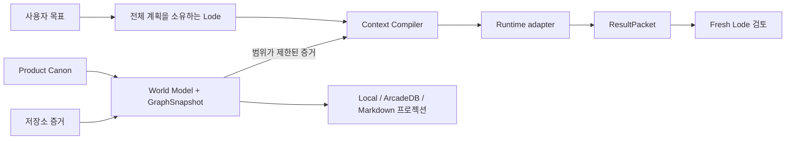
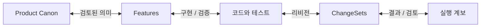

<p>
  
</p>

# Lode

[English](README.md) | **한국어** | [Documentation](docs/README.md) | [한국어 문서](docs/ko/README.md)

AI 대화가 바뀌어도 프로젝트의 방향과 변경 이유를 이어갑니다.

Codex, Claude Code, OpenCode에서 사용할 수 있습니다. 대화 압축 뒤에 저장된 작업을 복구하고, 지금 할 일에 필요한 맥락을 준비합니다.

[](https://github.com/binary1215/lode/actions/workflows/go-worker-build-release.yml)


<details>
<summary>목차</summary>

[왜 사용해야 하는가](#왜-사용해야-하는가) ·
[누구에게 필요한가](#누구에게-필요한가) ·
[일반 사용법](#일반-사용자는-어떻게-사용하나요) ·
[설치](#설치) ·
[고급 사용](#cli-자동화와-고급-설정) ·
[핵심 모델](#핵심-모델) ·
[그래프](#그래프와-기록) ·
[기능 현황](#기능-현황) ·
[문서](#문서)

</details>

## Lode Agent Core가 하는 일

Lode는 합의한 목표와 변경의 근거, 남은 할 일을 프로젝트 기록에 남깁니다. 다음 대화에서는 이전 채팅의 기억에 의존하지 않고 이 기록을 읽어 작업을 이어갈 수 있습니다.

Codex, Claude Code 또는 연동한 OpenCode에서 평소처럼 코딩 에이전트와 대화하면 됩니다. 별도 프로그램을 조작할 필요는 없습니다.

<a id="first-request"></a>

## 첫 요청은 이렇게 해보세요

아직 설치하지 않았다면 코딩 에이전트에게 이 README와 함께 요청하세요.

```text
Codex에 Lode를 기존 공식 설치 경로로 설치해줘. 유효한 설치가 있으면 재사용하고,
프로젝트 지침과 현재 연결은 보존해줘. 직접 할 수 있는 절차는 수행하고,
내가 해야 할 부분만 알려줘. 그다음 이 프로젝트의 로그인 오류를 조사해줘.
```

Codex와 작업 내용을 사용하는 클라이언트와 목표로 바꾸면 됩니다. 이미 설치된
Skill 없이도 이 README에서 시작할 수 있습니다. 에이전트는 현재 권한으로 가능한
절차를 수행하고 결과를 확인한 뒤 원래 작업을 이어갑니다. Host 승인·로그인·수동
재시작은 사용자가 해야 할 수 있으며 앱을 임의로 재시작하지 않습니다.

[플러그인을 설치하고 불러온 뒤](#설치) 프로젝트를 열고, 첫 요청에 실제 작업까지 함께 말하세요. 설정만 위한 별도 대화는 필요하지 않습니다.

```text
이 프로젝트에 Lode Agent Core를 사용해줘. 기존 상태가 있으면 이어서 재개하고,
없으면 Core를 초기화한 뒤 이 로그인 오류의 원인을 찾아서 수정해줘.
```

로그인 오류 대신 원하는 작업을 넣으면 됩니다. Lode는 초기화와 검증된 복구 뒤에도 그 작업을 이어가므로 같은 대화에서 계속 요청할 수 있습니다.

## 일반 사용자는 어떻게 사용하나요?

[첫 요청 예시](#first-request)처럼 원하는 결과를 말하고, 이후에도 자연어로 작업을 요청하세요.

```text
이 변경에 필요한 코드와 결정 근거만 준비한 뒤 진행해줘.
```

```text
전체 계획은 하나로 유지하고, 서로 독립적인 부분만 워커로 나눠 병렬로 진행해줘.
```

Lode는 보통 직접 작업합니다. 위임이 도움이 되면 현재 도구의 워커에게 명확한 범위를 주고 결과를 확인해 통합합니다. 도구가 위임을 지원하지 않으면 직접 또는 순차로 진행합니다. 일반 위임에 관리형 Run, 워커 원장이나 추가 승인은 필요하지 않습니다.

### 대화는 독립적으로, 방향은 함께 유지합니다

독립 작업은 각자의 작업 세션에서 진행하면서 프로젝트의 공통 목표와 현재 제약을 공유할 수 있습니다. 새 대화를 시작해도 다른 작업의 진행 상황은 유지됩니다. 사용자가 세션 ID를 관리하거나 경로 양식을 채울 필요는 없습니다. [그래프 탐색과 독립 Session](docs/ko/graph-discovery.md)을 참고하세요.

대화 압축이나 공급자 교체 뒤에는 대화 진입 시 저장된 작업 방향을 확인합니다. 사용자가 복구를 요청하거나 체크포인트 ID를 줄 필요는 없습니다.

Claude Code와 Codex 패키지는 compact를 포함한 SessionStart에서 맥락을 전달합니다. OpenCode V1 플러그인은 요약 요청과 이후 일반 요청을 포함한 매 모델 요청에 맥락을 전달하며, 압축 직후 이벤트를 처리하는 방식은 아닙니다.

이 경로는 저장된 기록을 읽을 뿐 미저장 대화를 수집하거나 관리형 일회성 작업 재개를 수행하지 않습니다. 설치된 Host와 실제 모델에서의 검증은 별도입니다. [지원 범위](#기능-현황)를 확인하세요.

JSON을 쓰거나 GraphDB를 조작하거나 토큰 단계를 고르거나 MCP 호출을 결정할 필요는 없습니다. 제품 의미 승인, 모호한 범위 결정, 중요한 외부 변경처럼 실제 결정권이 사용자에게 있는 경우에만 Lode가 확인합니다. 일반 조사와 작은 승인된 수정에 별도 절차를 더하지 않습니다.

## 왜 사용해야 하는가

프로젝트가 한 번의 대화보다 오래 이어질수록 도움이 됩니다.

### 대화 압축이나 세션 손실 후에도 이어갑니다

저장한 목표, 결정, 진행 상황과 다음 단계에서 작업을 이어갑니다. 복구할 때는 현재 제약을 확인하며, 오래된 다음 단계보다 사용자의 새 요청이 우선합니다. 체크포인트는 의미 있는 변경이나 인수인계 때 남깁니다. 짧은 조사는 Run이나 체크포인트 없이 필요한 이유와 불확실성만 남길 수 있습니다. 어느 쪽이든 매 턴 기록을 만들 필요는 없습니다.

복구 범위는 기록된 작업 방향이므로 저장하지 않은 대화는 사라질 수 있습니다. Host별 지원은 [대화 압축 복구](docs/ko/compaction-recovery.md), [Session 복구](docs/ko/session-recovery.md), [작업 맥락과 Host 지원](docs/ko/session-work-context.md)을 참고하세요.

### 범위가 명확하고 검토 가능한 컨텍스트를 전달합니다

원하는 변경을 말하면 Lode가 저장소를 읽고 필요한 코드와 결정 근거를 고릅니다. 맥락 전달이 필요할 때 Context Compiler가 선택한 자료를 묶고 제외 내용과 불확실성을 알립니다. 단어가 일치한다는 이유만으로 관련성이 입증되지는 않습니다. 사용자가 근거 양식을 쓰거나 예산을 관리할 필요는 없으며, Compiler도 실제 포함 여부나 의미적 충분성을 인증하지 않습니다. [Context Compiler](docs/ko/context-compiler.md)에서 자세히 설명합니다.

### 무엇을 바꿨는지뿐 아니라 왜 바꿨는지 검토합니다

Git은 바뀐 내용을 보여줍니다. Lode는 의도한 결과, 허용 범위, 검증, 리뷰와 다음 단계도 남깁니다. 관리형 작업에서 워커의 결과는 스스로 승인이 되지 않으며, 독립 검토와 명시적 결정을 구분합니다. [실행 계보](docs/ko/execution-lineage.md)와 [ChangeSet](docs/ko/change-sets.md)을 참고하세요.

기록된 이유와 인용한 소스의 차이는 [기록 맥락 보기](docs/ko/context-lineage.md)로 확인하거나, Lode에게 로컬 읽기 전용 [Graph Explorer 스냅샷](docs/ko/graph-explorer.md)을 요청하세요. 인용이나 이웃 노드만으로 변경 원인이 입증되지는 않습니다.

### 제품 의도를 코드와 테스트에 연결합니다

검토한 제품 개념에서 파일·심볼·테스트까지 따라가고, 제안된 변경 영향을 살펴볼 수 있습니다. 추론한 의미는 사용자가 수용하기 전까지 후보로 남습니다. [Feature mapping](docs/ko/feature-mapping.md)을 참고하세요.

### 그 밖의 장점

선택 기능으로 Git·배포 근거, 제품별 관측, 정책과 코드의 차이, 측정값을 기록할 수 있습니다. 수집한 데이터가 스스로 제품 결정이 되지는 않으며, 커넥터가 없어도 일반 코딩은 계속할 수 있습니다. 분석 서비스나 운영 DB용 커넥터가 모두 기본 제공되지는 않습니다. [기능 현황](#기능-현황)과 [문서](#문서)에서 지원 범위를 확인하세요.

## 누구에게 필요한가

| 이런 작업을 한다면 | Lode가 돕는 부분 |
| --- | --- |
| 여러 AI 대화에 걸쳐 제품을 개발 | 매번 방향을 다시 설명하지 않고 이어갑니다. |
| 크거나 오래된 저장소를 유지보수 | 이전 결정까지 포함해 변경에 필요한 근거를 찾습니다. |
| 팀원이나 여러 워커와 협업 | 소유 범위·결과·검토를 구분하며 하나의 성과로 통합합니다. |
| Codex·Claude Code·OpenCode를 함께 사용 | 프로젝트 기록을 특정 provider 대화와 분리합니다. |

한 번 끝나는 스크립트나 대화 기록만으로 충분한 짧은 실험이라면 필요하지 않을 수 있습니다. Lode가 모델 출력을 자동으로 신뢰하게 해주는 것은 아니며, 그래프나 DB가 제품의 의미를 결정하지도 않습니다.

## 설치

사용하는 도구의 설치 경로 하나를 선택하세요. Codex와 Claude Code 패키지는 대화형 Skill, MCP 서버, 지원 호스트용 검증된 네이티브 번들을 포함합니다. 실행 시에는 현재 호스트와 일치하는 바이너리만 사용합니다. OpenCode는 아래 프로젝트 설정을 따르며, 일반 대화에 CLI 설치가 필요한 것은 아닙니다.

[Codex에 설치](#codex-git-마켓플레이스) ·
[Claude Code에 설치](#claude-code-git-마켓플레이스) ·
[OpenCode 설정](#claude-code-및-opencode-프로젝트-프로젝션)

파일 설치, 선택한 프로젝트의 초기화·재개, 선택적인 지침 연결, 실제 Host 도구
로딩은 서로 다른 결과입니다. 에이전트는 확인한 범위를 구분해 설명합니다.
CLI 버전이나 생성 파일만으로 Host가 이를 읽었다고 보고하지 않습니다.
별도의 doctor·설정 확인 절차를 사용자가 반복할 필요는 없습니다.

신규 설치는 `lode-agent-core@lode-agent-plugin`을 사용합니다. 이미 HEAD를 쓰고 있다면 기존 설치를 계속 업데이트하면 됩니다. 두 번째 플러그인을 설치하거나 프로젝트 기록을 변환할 필요는 없습니다. MCP 서버의 이름은 `lode`입니다.

Host 권한이나 자동화가 `mcp__head_core__...` 또는 `mcp__lode_core__...`를
참조한다면 Core의 `head_*` 별칭으로 자동 전환되지 않습니다. 업데이트를
불러온 뒤 Host의 실제 MCP 도구 목록에서 `lode` 서버와 정확한 도구명을
확인하고, 사용자가 관리하는 규칙을 바꿀 때 그 이름을 사용하세요. 변경을
선택하기 전에는 기존 설정과 실행 중 연결을 보존하세요. 디스크 업데이트만으로
Host가 reload되지는 않습니다. 자세한 내용은 [MCP 이름 안내](#mcp-name-details)를
참고하세요.

### Codex Git 마켓플레이스

중간 베타는 검증된 마켓플레이스 게시로 배포하며 Git 태그는 별도 지정 릴리스에만
만듭니다. [변경 기록과 게시 정책](CHANGELOG.ko.md)을 참고하세요.

저장소는 `binary1215/lode`이며, Lode 마켓플레이스는 `lode-codex-marketplace`
브랜치에 게시됩니다. 이전 저장소 주소도 이곳으로 연결됩니다.

```powershell
codex plugin marketplace add binary1215/lode --ref lode-codex-marketplace
codex plugin add lode-agent-core@lode-agent-plugin
```

설치 후 Codex를 재시작하고, 설치된 Skill과 MCP 서버를 불러오도록 새 작업을
시작한 뒤 [첫 요청 예시](#first-request)에 원하는 작업을 넣어 요청하세요.

플러그인을 설치해도 프로젝트 초기화, GraphDB 접속, 모델 선택이나 Product
Canon 승인이 자동으로 이뤄지지는 않습니다. 해당 작업은 Core의 정해진 경계를
거치며, 중요한 변경에는 사용자의 명시적 검토가 필요합니다.

### Claude Code Git 마켓플레이스

```powershell
claude plugin marketplace add binary1215/lode@lode-claude-marketplace
claude plugin install lode-agent-core@lode-agent-plugin
```

설치 후 Claude Code를 재시작해 Skill과 `lode` MCP 서버를 불러온 뒤
[첫 요청 예시](#first-request)에 원하는 작업을 넣어 요청하세요.

Claude Code는 플러그인을 버전별 캐시에 복사하고 `${CLAUDE_PLUGIN_ROOT}`를
기준으로 MCP 진입점을 찾습니다. 소스 Core와 기존 Project 식별자는 유지합니다.
설치만으로 프로젝트 변경, Product Canon 검토, GraphDB 접속이나 모델 선택이
승인되지는 않습니다.

### Claude Code 및 OpenCode 프로젝트 프로젝션

아래 사용자 범위 설치를 쓰는 경우 OpenCode는 `--runtime opencode`, Claude Code는
`--runtime claude`, Codex는 `--runtime codex`로 선택한 클라이언트만 초기화합니다.
여러 통합을 원할 때만 쉼표로 조합합니다. 마켓플레이스로 설치한 Claude Code 사용자는 번들 Skill에 같은
초기화를 요청할 수 있습니다. 프로젝트에 해당 파일이 없을 때만 Claude Code용
`CLAUDE.md`와 `.mcp.json`, Codex용 `AGENTS.md`, OpenCode용 `opencode.json`을
만듭니다. 기존 파일은 보존하고 직접 통합할 때 쓸 생성 파일은 선택된 정본 루트의
`.lode/generated/` 또는 기존 `.head/generated/`에 둡니다.

OpenCode 로컬 설정은 각 PC의 Node 실행 파일과 Lode 설치 경로를 사용합니다.
설치 경로가 바뀌면 해당 PC에 Lode를 설치한 뒤 에이전트에게 기존 Project 재개를
요청하세요. 같은 정본 Project 경로에서는 Project·Session ID와 런타임 구성을
유지하며 관리되는 경로를 갱신합니다. 사용자 소유 `opencode.json`은 그대로 두고
생성본만 갱신하므로, 필요한 설정 통합에 그 생성본을 사용할 수 있습니다.

Project 폴더 전체를 이동하거나 복사했다면 새 경로에서 명시적으로 재개하세요.
Lode는 보존된 소유 정보를 검증하고 Project·Session ID와 과거 기록을 유지합니다.
상태 조회만으로 새 위치를 채택하지 않으며, native Host 바인딩을 이전하거나 실행을
재생하지 않습니다. [Session 복구](docs/ko/session-recovery.md)를 참고하세요.
실행 중인 Host가 MCP 도구를 로드했는지는 별도로 확인하세요.

설정 중 지침 연결을 선택하면 기존 지침 파일의 원문을 보존하면서 작은 블록을
한 번만 덧붙일 수 있습니다. Claude Code에는 지침 파일 import를 사용하고,
Codex에는 프로젝트 지침을 읽도록 안내합니다. 거절하면 파일을 바꾸지 않으며
작업을 막거나 설정을 다시 제안하지 않습니다. 사용하는 Host의 설치 안내를
따르세요. 지침을 생성했다는 사실만으로 실행 중인 Host가 읽었다고 볼 수는 없습니다.

초기화 후 프로젝트에서 `claude`나 `opencode`를 시작하세요. Claude Code는
공유 `lode` 서버를 처음 사용할 때 프로젝트 MCP 승인을 요청합니다. 런타임별
지시·설정 파일은 프로젝트 기록을 읽어 만든 결과입니다. 프로젝트 정본은 선택된
`.lode/` 또는 기존 `.head/` 하나로 유지됩니다.

### 사용자 범위 CLI

<details>
<summary>선택 사항인 사용자 범위 CLI 설치 보기</summary>

지원하는 런타임은 Node.js 24 이상이며 CI는 Node.js 24.18.0을 사용합니다.
Git 또는 다운로드한 소스 아카이브도 필요합니다.
대상 프로젝트 내부의 Git, Go, GraphDB, 공급자 런타임은 선택 사항입니다.

Windows PowerShell:

```powershell
git clone https://github.com/binary1215/lode.git lode
Set-Location .\lode
.\scripts\install.ps1 --native auto --project C:\path\to\project --runtime codex

lode-agent --version
```

macOS 또는 Linux:

```bash
git clone https://github.com/binary1215/lode.git lode
cd lode
./scripts/install.sh --native auto --project /path/to/project --runtime codex

lode-agent --version
```

설치 프로그램은 내용이 검증된 릴리스를 현재 사용자의 데이터 디렉터리에
준비하고 `~/.local/bin`에 실행 파일을 만듭니다. 명시적인 `--project` 초기화
단계 전에는 셸 프로필, Codex 캐시, 원격 GraphDB 또는 기존 프로젝트를
수정하지 않습니다.
위 예시는 Codex만 선택합니다. 해당 클라이언트에 맞게 `codex`를 `claude` 또는
`opencode`로 바꾸세요. `--version`은 실행 중인 CLI 버전이지 Host에 로딩된 도구의
증거가 아닙니다. status·doctor 진단은 필요한 경우에만 사용하면 됩니다.

</details>

<details>
<summary id="mcp-name-details">기존 HEAD 사용자: 설치 식별자와 MCP 이름 안내</summary>

신규 Lode 설치는 `lode-agent-core@lode-agent-plugin`, `lode_*`와 Lode Skill 이름을 사용합니다. 기존 `codex-marketplace`와 `claude-marketplace` 주소는 `head-agent-core@head-agent-plugin`, `head_*`와 기존 Skill 이름을 유지합니다. 각 패키지는 `lode` 서버 하나와 도구 이름 한 벌만 노출하며, 같은 구현을 사용합니다. 두 패키지를 함께 설치하지 말고 현재 사용하는 마켓플레이스를 유지하세요.

기존 HEAD 설치는 지금까지 쓰던 명령으로 업데이트합니다.

```powershell
codex plugin marketplace upgrade head-agent-plugin
codex plugin add head-agent-core@head-agent-plugin
```

```powershell
claude plugin marketplace update head-agent-plugin
claude plugin update head-agent-core@head-agent-plugin
```

기존 `.head/` 기록·ID·선택 Session은 그대로 유지하고 새 프로젝트는 `.lode/`를 사용합니다. 작업 별칭은 Host가 소유하는 `mcp__head_core__...`나 `mcp__lode_core__...` 이름을 자동 연결하지 않습니다. 디스크 업데이트가 실행 중 Host의 reload를 뜻하지는 않습니다. 사용자 소유 설정은 보존하고 생성된 대안에 새 서버명을 사용합니다. 검증된 롤백을 위해 과거 패키지의 원본 바이트와 서버명도 유지합니다.

</details>

## 기능 현황

아래 상태는 소스 배포판의 구현 범위를 나타냅니다. 특정 Host에 설치해 실제 모델까지 검증했다는 뜻은 아닙니다. 저장된 맥락 전달에는 미저장 대화 수집이나 관리형 자동 작업 재개가 포함되지 않습니다.

<details>
<summary>구현·실험·미출시 기능</summary>

- 사용 가능: 현재 소스 배포판에 구현됨
- 실험적: 명시적이거나 제한된 활성화 경로 뒤에 구현됨
- 계획됨: 방향은 채택했지만 아직 배포되지 않음
- 보류됨: 현재 마일스톤 범위에서 의도적으로 제외됨

| 영역 | 기능 | 상태 |
| --- | --- | --- |
| 프로젝트 | 초기화, Source Scope, 검토를 거치는 Product Canon | 사용 가능 |
| 지식 | 원본 fallback을 갖는 제한된 그래프 우선 탐색, World Model, 증분 갱신, 선택적 Context Capsule | 사용 가능 |
| Session | 독립 논리 Session 라우팅, 공통 현재 방향과 정확한 기준의 갱신 | 사용 가능 |
| 계보 | Run, ResultPacket, Fresh Lode 검토, P2 Session 및 대화 진입 복구 | 사용 가능 |
| Host lifecycle | 신뢰하는 Host 어댑터가 필요한 공급자 중립 compaction·최대 1회 continuation 계약 | 실험적 |
| Host context | compact를 포함한 Claude Code·Codex 패키지의 SessionStart 맥락 전달 | 사용 가능 |
| Host context | OpenCode V1 패키지의 요약·일반 모델 요청별 맥락 전달. 압축 직후 이벤트 아님 | 사용 가능 |
| 런타임 | Claude Code, Codex, OpenCode 일회성 Session/Run 실행 | 사용 가능 |
| 런타임 증거 | 세 런타임 결정론적 fixture 및 로컬 CLI 기능 probe | 사용 가능 |
| 런타임 증거 | Claude Code 실제 모델 호출 적합성 | 실험적 |
| 릴리스 증거 | 공급자 중립 Git ref, deployment-result 및 release observation | 사용 가능 |
| 전달 증거 | 공급자 중립 환경/대상별 applied, failed, rollback 이력과 선택적 exact source-revision link | 사용 가능 |
| 공통 관측 | 기존 exact evidence 우선 준비, Host source 페이지 탐색, opaque ID 수집 | 사용 가능 |
| 제품 정책 | schema-v2 Policy proposal, 정확한 적용 대상과 semantic reference, user review, evidence-currentness 진단, revision 및 retirement lineage | 사용 가능 |
| 측정 | versioned metric definition, exact observation, condition-aware comparison, non-causal assessment 및 bounded lineage | 사용 가능 |
| 워커 | 범위가 제한된 전달, 대기, 결과, 검토, 통합 | 사용 가능 |
| 역할 통신 | 일반 Host 위임과 선택적인 정확한 엔드포인트 연결 | 사용 가능 |
| 프로젝션 | 로컬 그래프와 Markdown | 사용 가능 |
| 프로젝션 | ArcadeDB | 실험적 |
| 배포 | 사용자 범위 설치, 네이티브 전달, 롤백, 안전한 제거 | 사용 가능 |
| 배포 | 검증된 Git 기반 Codex 마켓플레이스 | 사용 가능 |
| 배포 | 검증된 Git 기반 Claude Code 마켓플레이스 | 사용 가능 |
| 배포 | OpenAI 범용 플러그인 디렉터리 | 계획됨 |
| 런타임 | 일반 공급자 세션 resume과 stream | 보류됨 |
| 문서 | Obsidian 및 Notion 어댑터 | 보류됨 |

정확한 주장과 승인 증거는 이 요약에서 추론하지 말고 하위 시스템 문서와
소스 검증을 사용하세요.

</details>

## 문서

변경 기여와 민감한 문제 신고는 [기여 안내](CONTRIBUTING.ko.md)와
[보안 안내](SECURITY.ko.md)를 참고하세요. 이 문서들은 배포·게시 권한을 부여하지 않습니다.

[전체 영문 문서 색인](docs/README.md)과 [전체 한국어 문서 색인](docs/ko/README.md)을
제공합니다. 모든 공개 영문 하위 시스템 문서에는 한국어 대응본이 있으며, 코드,
명령 이름, 프로토콜 식별자, 아티팩트 필드 이름은 두 언어에서 동일하게 유지합니다.

<details>
<summary>하위 시스템 안내</summary>

- [복구·Session 선택·World 최신성](docs/ko/recovery-state-separation.md): 저장된 방향, Session 경로와 파생 World 상태의 구분
- [아키텍처](docs/ko/architecture.md): 공급자 중립적 구성
- [권한 평면](docs/ko/authority-plane-contract.md): 실행 가능한 Graph/record 및
  권한 비증폭 계약
- [온보딩](docs/ko/onboarding.md): Lode semantic proposal, Core 검증과 명시적 검토
- [Context Compiler](docs/ko/context-compiler.md): 재현 가능한 작업 컨텍스트
- [작업 산출물 저장](docs/ko/artifact-storage.md): 추가 절차 없이 근거를 저장하고 찾는 방법
- [실행 계보](docs/ko/execution-lineage.md): 계획, 계약, 결과, 검토, 복구
- [World Model](docs/ko/world-model.md): 소스 증거와 그래프 구성
- [런타임 어댑터](docs/ko/runtime-adapters.md): 기능, 호출, 프로세스 소유권
- [성능 fast path](docs/ko/performance-fast-path-design.md): 의미 또는 권한을
  생략하지 않는 최적화

추가 참고 문서:

- [Product Model](docs/ko/product-model.md)
- [Product Operating Loop](docs/ko/product-operating-loop.md)
- [Release observation](docs/ko/release-observation.md)
- [공통 Observation 계약](docs/ko/observation-adapters.md)
- [전달 상태 관측](docs/ko/delivery-observation.md)
- [비차단 Conformance 재정](docs/ko/conformance-reconciliation.md)
- [증분 갱신](docs/ko/incremental-refresh.md)
- [컨텍스트 압축 복구](docs/ko/compaction-recovery.md)
- [Session 복구](docs/ko/session-recovery.md)
- [일반 Host 위임과 선택적 연결](docs/ko/role-coordination.md)
- [그래프 프로젝션 어댑터](docs/ko/graph-projection-adapter.md)
- [문서 프로젝션 어댑터](docs/ko/document-projection-adapter.md)
- [Codex 마켓플레이스 배포](docs/ko/codex-marketplace.md)
- [Claude Code 마켓플레이스 배포](docs/ko/claude-marketplace.md)

실제 동작은 런타임 계약, 대상 프로젝트의 사용자 소유 Canon, 현재 Session/Run
복구 상태와 명시적 ReviewDecision을 따릅니다. 저장소 개발 이력, 벤치마크
픽스처와 유지관리자 마일스톤은 플러그인 개발의 근거이며, 사용하는 프로젝트의
지시로 적용하지 않습니다.

</details>

## CLI, 자동화와 고급 설정

<details>
<summary>CLI 명령과 컨텍스트 준비</summary>

일반 사용자는 위의 대화 경로를 쓰면 됩니다. CLI는 스크립트, CI, 오프라인 복구나
Host 연동에서 안내 대화 없이 같은 결정론적 Core 동작을 실행할 때 사용합니다.

기본 경로는 공급자 중립 Lode 헌법과 고정 Project/Session 복구 앵커만
초기화합니다.

```powershell
lode-agent init C:\path\to\project --runtime claude,codex,opencode
```

이 경로는 ID를 보존하고 가능한 기존 관측 자료의 경량 색인을 갱신하면서
`core_ready`를 반환합니다. 제품 의미 추론, 관리 World 구성과 문서 거버넌스는
선택 사항으로 남습니다. 같은 범위 제한 상태는 언제든 확인할
수 있습니다.

```powershell
lode-agent status C:\path\to\project
```

정상 상태는 한 줄로 보여줍니다. 예외가 있으면 담당 주체, 이유, 영향을 받는
작업과 다음 행동을 표시합니다. `doctor` 또는 `--json`에서는 Core, 선택적 Product
관리, Context 준비도, 실행 중인 CLI·라이브러리와 구성된 패키지의 버전, 기술
세부 정보를 확인할 수 있습니다. 이 패키지 조회만으로 Host 도구 로딩을 확인하지는
않습니다. 구조화된 결과는 `readiness.core`, `readiness.product`,
`readiness.context`를 나누어 보여주고, 지금 수행할 `nextAction` 하나와 선택 기능의
실제 선행조건을 표시합니다. Product는 `available-not-activated`, 관리형 bounded
worker는 `requires-session-or-run-authorization`으로 표시됩니다. 일반 독립 검토는
현재 Host의 위임을 쓰며, 워커 수만으로 Run을 요구하지 않습니다. 이 조회 결과는
저장하지 않으며 Product 활성화, Run 생성, 권한 부여나 드리프트 복구를 일으키지
않습니다. `profile`은 한 번의 초기화·재개 범위를 선택하는 값이며 숨은 프로젝트
모드가 아닙니다.

최상위 상태는 `core_ready`, `product_evidence_required`, `product_review_required`,
`product_ready`, `product_refresh_required`, `core_drifted` 중 하나입니다. 세부 온보딩
상태는 `readiness.product.onboardingStatus`에 남습니다.

### 대화형 Context 준비와 미리보기

대화에서는 원하는 작업을 한 번만 설명하면 됩니다. 일반 읽기·수정에는 필요한
파일을 직접 확인합니다. 선택한 맥락을 재현해 전달하거나 지속 가능한 Run과
복구에 Capsule이 필요할 때만 Lode Skill이 `lode_context_prepare`를 호출합니다.
저장소 내용을 읽고 필요한 `EvidenceNeed[]`를 작성한 뒤 `lode_context_preview`로
이어갑니다. 선택적 World 근거가 없거나 오래됐어도 직접 작업은 계속하며,
필요성이 확인되면 예산을 자동으로 늘립니다. 최종 미리보기는 포함된 근거의 종류,
제외 이유와 남은 불확실성을 설명 카드로 보여줍니다. 추가 절차 없이 기계적 확인
범위는 Core가, 의미적 충분성은 Lode가 담당합니다.

기본 MCP 목록은 Core 작업, 복구, 기존 작업의 상태 조회와 취소에 집중합니다.
Lode는 선택적 Product·Graph·Observation·Context 스키마를 `lode_tools_discover`로
찾고, 반환된 읽기 전용 또는 효과 실행 경로를 호출합니다. 사용자가 기능 잠금을
해제하거나 매번 프로필을 고르거나 JSON을 작성할 필요는 없습니다. 탐색이 권한을
부여하지는 않으며 기존 작업의 권한·효과 검사는 그대로 적용됩니다.

자동화와 진단을 위해서는 같은 Core 동작을 CLI에서도 사용할 수 있습니다.

```powershell
lode-agent context-prepare C:\path\to\project --task "<task>"
```

이 작업 전용 P4 조회는 현재 Project·World Model·GraphSnapshot의 연결, 범위가
제한된 어휘 기반 탐색 자료와 정확한 노드 식별자를 반환하며 결과를 저장하지
않습니다. 사용자는 `EvidenceNeed[]`를 작성하지 않습니다. Lode가 저장소를 읽고
의미를 판단해 구조화된 제안을 만든 뒤 기존 미리보기 검증기에 전달합니다.
Core는 근거의 종류나 기준 노드를 고르지 않으며, 어휘 기반 후보에 없다는 이유로
관련 없는 자료로 단정하지 않습니다.

Product/World가 활성화되지 않아도 준비 결과는
`ready_for_head_semantic_assessment`입니다. 저장소 메타데이터가 없음을 알리고
사용 가능한 정리된 맥락을 제공합니다. Lode는 현재 원본 소스를 직접 조사할 수
있습니다. 준비 과정은 Product를 활성화하거나 저장소를 인덱싱하거나 복구 기록을
만들지 않습니다. Product/World 작업은 해당 작업에 필요할 때만 선택합니다.

고급 자동화에서는 Lode가 작성한 구조화 입력으로 미리보기를 직접 호출할 수 있습니다.

```powershell
lode-agent context-preview C:\path\to\project `
  --task "재시도에서도 이 작업 문구를 정확히 유지" `
  --budget 32768 `
  --evidence-needs .\evidence-needs.json
```

CLI는 기본적으로 결과를 짧게 보여줍니다. `--json`을 추가하면 선택 맥락, 출처,
누락과 불확실성을 확인할 수 있습니다. 결과가 유용하면 준비 또는 미리보기 호출
하나로 충분하며, 별도 미리보기는 선택 사항입니다.

`ready_for_head_semantic_assessment`는 Lode가 선택한 맥락을 판단하라는 뜻이며,
도구가 완전성을 증명했다는 뜻은 아닙니다. Lode는 필요한 원본 본문을 읽고
반환된 그래프 기준 노드를 `details: true`로 확대할 수 있습니다. World가 없거나
오래됐음을 알리며 현재 소스는 직접 사용할 수 있습니다. 고정 예산 단계, 포함
증명서나 추가 사용자 승인은 요구하지 않습니다.

### 대화 우선 경로

번들 `lode-agent-onboarding` Skill은 Product 온보딩의 권장 대화형 진입점입니다.
현재 상태를 검사하고 저장소 범위나 저장 방식처럼 중요한 선택만 질문합니다.
범위가 정해진 최신 근거를 읽고 Core 검증용 제안을 제출한 뒤, 근거가 연결된
후보를 보여줍니다. Product Canon을 바꾸기 전에는 명시적 검토를 거칩니다.
이 Skill은 `product` 프로필을 명시적으로 선택하며 공급자의 제안은 P3 근거로 남습니다.

### 선택적 Product 프로필 CLI 경로

동일한 프로젝트 및 Lode Session 식별자를 초기화하거나 재개합니다.

```powershell
lode-agent init C:\path\to\project --runtime claude,codex,opencode --profile product
lode-agent onboarding-status C:\path\to\project
```

구조화된 사용자 설명이 없으면 처음 실행은 `awaiting-evidence`를 반환합니다.
Core는 심볼 이름에서 제품 개념을 만들어 내지 않습니다. 대화 Skill은 최신 근거에
따른 의미 제안을 제출하며, CLI 사용자는 같은 `semanticProposal`을 `--input`에
넣을 수 있습니다. Core가 정확한 SourceSnapshot, 경로, 줄, 선택적 심볼과 Product
Model 참조를 검증한 뒤 변경 불가능한 후보 집합 ID를 반환합니다. 검토 전에 내용을 확인하세요.

```powershell
$onboarding = lode-agent onboarding-status C:\path\to\project | ConvertFrom-Json
lode-agent onboarding-candidates C:\path\to\project `
  --candidate-set $onboarding.state.candidateSetId
```

증거를 검토한 뒤에만 `onboarding-review.json`을 만드세요. 아래의 간단한
예시는 전체 부트스트랩 후보를 승인합니다. 이름 변경, 분리, 병합 또는 제외할
후보가 있다면 선택 승인이나 수정이 더 안전합니다.

```json
{
  "candidateSetId": "onboarding-candidates-<id>",
  "disposition": "accept-all",
  "rationale": "증거가 연결된 모든 후보를 검토했으며 이 부트스트랩 후보 집합을 채택합니다."
}
```

결정을 적용하고 생성된 뷰를 검증합니다.

```powershell
lode-agent onboarding-review C:\path\to\project --input .\onboarding-review.json
lode-agent graph-query C:\path\to\project --query "<task>"
lode-agent world-status C:\path\to\project
lode-agent context-preview C:\path\to\project `
  --task "검토된 Feature 하나의 구현 증거 찾기" --budget 32768
lode-agent world-docs-build C:\path\to\project
lode-agent resume C:\path\to\project --runtime claude,codex,opencode --profile product
```

`accept-all`은 전체 후보를 직접 확인한 경우 사용할 수 있지만 기본 권장
방식은 아닙니다. 검토에서는 의존성이 완전한 일부 후보를 승인하거나, 후보
집합을 수정·거부하거나, 추가 증거를 요청하거나, 미해결 개념을 명시적인
Unknown으로 남길 수 있습니다. 전체 계약은
[온보딩 문서](docs/ko/onboarding.md)를 참고하세요.

### 소스 범위

생성 결과물, 벤더 의존성, 복사된 프로젝트, 대형 픽스처 또는 모델 번들이
포함된 저장소에서는 첫 인덱싱 전에 프로젝트 기준 관찰 경계를 정의하세요.

```json
{
  "mode": "existing",
  "sourceScope": {
    "includeRoots": ["src", "packages"],
    "excludeRoots": ["dist", "vendor", "generated", "fixtures"]
  }
}
```

`lode-agent init ... --profile product --input .\onboarding.json`으로 전달합니다. Source Scope는
관찰 범위만 제어합니다. Product Canon을 정의하거나 후보를 승인하거나 실행
권한을 부여할 수 없습니다.

</details>

## 핵심 모델

<details>
<summary>권한, 컨텍스트와 복구 계약</summary>

Lode는 의미, 복구, 증거, 뷰, 효과를 분리하여 하나의 표현이 다른 표현의
권한을 상속하지 못하게 합니다.

| 평면 | 소유 대상 | 예시 | 부여하지 않는 권한 |
| --- | --- | --- | --- |
| P1 규범적 권한 | 승인된 의미와 명시적 결정 | Product Canon, ReviewDecision | 그래프·결과·메시지에서 승인을 추론하는 권한 |
| P2 복구와 계보 | 공급자와 독립적인 프로젝트 방향 | Session, Run, 계획, Capsule, 계약, 체크포인트 | 요약이나 결과로 방향을 다시 쓰는 권한 |
| P3 증거 | 검토 가능한 관찰과 결과 | 후보, ResultPacket, ChangeSet, 영수증 | 자기 승격이나 체크포인트 작성 권한 |
| P4 파생 뷰 | 재현 가능한 검색 및 사람용 뷰 | GraphSnapshot, 탐색 결과, Markdown, 연속성 뷰 | Canon 변경이나 유일한 복구 원천이 될 권한 |
| P5 운영 효과 | 호스트 로컬 실행과 전달 | PID, 임대, 엔드포인트, 받은 편지함, 전달 영수증 | 실행·검토·승격·복구 권한 |

배포와 호스트 통합은 이 계약을 패키징하거나 실행할 뿐, 제품 의미의 여섯
번째 원천이 되지 않습니다. 전체 실행 가능 경계는
[권한 평면 문서](docs/ko/authority-plane-contract.md)에 설명되어 있습니다.

기본 원칙과 Record/Graph의 공식 경계는
[공급자 중립 Lode 헌법](docs/ko/lode-constitution.md)에 설명되어 있습니다.

### 아키텍처 개요



피드백 경로도 명시적입니다. 승인된 결과는 검토된 계보가 될 수 있고,
저장소를 다시 인덱싱할 수 있으며, 이후 그래프가 그 증거를 투영할 수
있습니다. 결과, 프로젝션 또는 런타임 효과가 스스로를 승인할 수는 없습니다.

### Lode가 의미를 판단하고 Compiler가 선택 맥락을 제공하는 컨텍스트

Context Compiler는 명시적인 예산 안에서 작업용으로 선택한 증거를 묶습니다.
포함·제외·오래됨·누락·잘림·미확인 항목을 기록합니다. 동일한 정본 입력,
컴파일러 버전, 탐색 정책, 예산은 동일한 Context Capsule을 재현합니다.

예산의 기본값은 약 `32768` 토큰이며 Lode가 양의 안전한 정수를 선택할 수 있습니다.
고정된 다섯 계층이나 512K 정책 상한은 없습니다. 실제 공급자의 컨텍스트 크기와
출력 예약분은 계속 적용되며, 근사치가 토크나이저 기준의 적합성을 증명하지는 않습니다.

Lode는 정확한 저장소 경로, Product Canon 키, Observation ID나 범위가 정해진
현재 그래프의 기준 노드로 자료 선택을 안내할 수 있습니다. Compiler는 포함을
인증하는 대신 `evidenceGaps`, `omissions`, `uncertainty`를 제공합니다. 추가 소스가
필요한지는 Lode가 판단합니다. 저장된 ExecutionContract는 그 판단을 기록하며
의미적 수용을 기계적으로 만들어 내지는 않습니다.

Capsule은 파생된 실행 입력이지 두 번째 Canon이 아닙니다. 다이제스트 또는
Canon 드리프트는 실패 폐쇄되며, 단순한 읽기·추론 작업은 기본적으로
Capsule을 만들지 않습니다.

### 실행과 복구

관리형 실행은 다음과 같이 기록과 검토가 남는 순서를 따릅니다.

```text
WholePlanSnapshot
  → ExecutionContract + ContextCapsule
  → 런타임 또는 범위가 제한된 워커
  → ResultPacket
  → Fresh Lode ReviewDecision
  → 승인된 계보 또는 수정된 계획
```

공급자 손실 시 대화 기록을 가져올 필요가 없습니다. `session-restore`는 정확한
P2 체크포인트와 검증된 계보에서 현재 입력을 재구성합니다. 결과가 승인된
뒤에도 `run-integrate-checkpoint`는 Lode 또는 사용자가 복구 필드를 명시적으로
제공한 경우에만 그 검토를 새 체크포인트와 연결할 수 있습니다.

신뢰하는 Host 어댑터가 있을 때 관리형 컨텍스트 압축은 다음 계약을 따릅니다.
패키지의 읽기 전용 맥락 전달만으로 이 전체 절차를 수행하지는 않습니다.

1. 공급자 측 Lode가 압축 전에 정확한 P2 방향을 작성하거나 재사용합니다.
2. 공급자 중립 Host 어댑터가 일회용 전달 토큰을 프로젝트 Canon 밖에 보관하고
   공급자 소유의 압축을 수행합니다.
3. Core는 P2를 먼저 복원한 뒤 신뢰할 수 있는 실제 사용자 턴 근거를 검사합니다.
   기준 변경, 불확실한 재실행과 요약 기반 복구는 거부합니다.
4. Host가 체크포인트에 결속된 작업 재개 요청을 최대 한 번 제출하거나, Lode가
   검증된 기록에서 새로운 논리적 Lode로 계속함을 명시합니다.

일반 사용자는 작업을 계속 말하면 됩니다. Skill은 읽기 전용
`lode_conversation_enter`로 자동 진입하고, `compact-*`와
`lode_compaction_lifecycle_step`은 고급 어댑터와 진단 작업에 사용합니다.
Host Hook이 없어도 추가 설정을 요구하거나 일반 작업을 막지 않습니다.

방향을 지속 가능한 기록으로 갱신할 때 Skill은 내부적으로 읽기 전용
`lode_checkpoint_basis`와 멱등적인 `lode_checkpoint_sync`를 사용합니다. Core는
`created`, `reused`, `deferred`, `conflict` 중 하나를 반환하며, 필요한 경우 해당 복구
경로만 멈춥니다. 어느 결과도 사용자에게 체크포인트 JSON을 요구하지 않습니다.

복구 상태를 설명해야 할 때 `lode_checkpoint_diagnose`는 현재 포인터, 기록 복원
결과, 기계적 갱신 가능 여부와 다음 Lode 동작을 범위가 제한된 읽기 전용 응답으로
보여줍니다. 잠금이나 캐시를 쓰지 않고, 상태를 읽기 위해 다른 모델을 호출하지도
않습니다. ID와 해시 일치는 기록의 정합성을 증명하며 체크포인트 문장이 최신
사용자 의도를 반영한다는 뜻은 아닙니다. 순차 읽기 중 상태가 바뀌면 다시 읽어야
합니다. 원자적 파일시스템 스냅샷이나 ABA 감지는 보장하지 않습니다. 실제 복구
결함이 있어도 체크포인트 의존 작업만 멈추고 독립 작업은 계속할 수 있습니다.

사용자의 새 요청은 대기 중인 작업 재개보다 우선합니다. 자세한 내용은
[컨텍스트 압축 복구](docs/ko/compaction-recovery.md)와
[Session 복구](docs/ko/session-recovery.md)를 참고하세요.

### 제품 학습

일상적인 관찰은 지속하지 않는 메모로 남길 수 있습니다. 다른 Run, 감사,
제품 상태 전이 또는 인수인계에서 필요한 경우에만 영구 아티팩트를 만듭니다.

```text
Signal → Hypothesis → Initiative 후보 → 사용자 ReviewDecision
       → 검토된 Initiative → 승인된 실행 → OutcomeObservation
```

이 흐름은 하나의 자동 승격 사슬이 아닙니다. 증거는 증거로, 가설은 가설로
남고, 검토된 Initiative도 Product Canon과 구분됩니다.
Lode가 추천 API나 메모 형식화 호출 없이 위험과 필요한 지속성을 직접 판단합니다.

- Observe: 읽기와 추론 작업
- Session: 하나의 범위가 제한된 가역적 결과
- Run: 서로 의존하거나 복구 민감한 작업
- 명시적 권한: Canon·Initiative 결정 또는 현재 승인 범위 밖의 효과 실행.
  기존 승인 방향 안에서 유용한 checkpoint를 갱신하는 것은 새 사용자 결정이 아닙니다.

자세한 내용은 [Product Operating Loop](docs/ko/product-operating-loop.md)를
참고하세요.
Git ref와 배포 근거 수집은 [Release observation](docs/ko/release-observation.md)에,
환경별·대상별 적용, 실패와 롤백 이력은
[전달 상태 관측](docs/ko/delivery-observation.md)에 설명되어 있습니다.

</details>

## 그래프와 기록

<details>
<summary>스냅샷, 이력과 그래프 질의</summary>

Graph Explorer의 `graph-explorer <project-directory>` CLI는 플러그인 설치 폴더가
아닌 대상 프로젝트의 근거를 읽기 전용 HTML 스냅샷으로 만듭니다. 에이전트에게 기존
CLI 실행을 요청할 수 있으며, 별도 HTML 내보내기 MCP 도구는 없습니다. 실시간 화면은
아닙니다. 검색·명시적 과거 기록·공유 옵션은 [Graph Explorer](docs/ko/graph-explorer.md)를 참고하세요.

새 프로젝트 정보는 `lode_project_graph`의 범위가 정해진 관계 조회나 충분한 동일
기준 결과의 재사용으로 찾습니다. 작업과 Product 관점은 같은 원본을 참조하며,
온전한 과거 자료의 리비전, 출처, 확인 범위와 후보·거절 상태도 유지합니다.
없거나 실패한 층은 원본 탐색으로 보완하며 전체 World의 최신성, Product 승인,
Run/Capsule이나 ArcadeDB를 시작 조건으로 삼지 않습니다. 부분 결과가 비어 있어도
사실 부재로 단정하지 않습니다. 실제 효과는 현재 원본과 권한을 다시 확인하며
조회마다 새 기록을 만들지 않습니다.
[그래프 탐색과 독립 Session](docs/ko/graph-discovery.md)을 참고하세요.


`GraphSnapshot`은 검증된 하나의 Repository World Model에 포함된 변경 불가능한
콘텐츠 주소 기반 증거 그래프입니다. 그래프 UI의 스크린샷, 데이터베이스
백업, 변경 가능한 최신 노드 집합이 아닙니다. 동일한 검증 입력은 동일한
`graphSnapshotId`를 생성하고, 의미가 달라지면 명시적인 계보를 가진 새
스냅샷이 생성됩니다.

`lode_world_model`은 전체 모델과 현재 저장소를 빠짐없이 검증한 뒤, 전체
스냅샷 대신 크기가 제한된 상태 조회 결과를 반환합니다. 개수, ID, 다이제스트,
표본과 생략 정보는 유지합니다. 더 자세한 내용은 범위가 제한된 그래프·이력·
런타임·의미 질의 도구로 확인합니다. 최신성이나 다이제스트 계산을 생략하지 않고
MCP 응답 크기를 줄입니다.



원시 프롬프트는 이 그래프 밖에 남습니다. 제품 의미는 검토된 Canon
아티팩트를 통해서만 들어옵니다. 일반 탐색은 후보·거절 기록의 원래 상태를
표시하면서 읽을 수 있으며 Canon Context 컴파일에서 승격하지 않습니다.

공통 Observation의 정확한 설명자, 수집 영수증과 도출 계보도 같은 시계열 그래프에
들어갑니다. ProductHypothesis가 정확한 Observation을 가리켜도 그 관계는 가설의
근거로만 남으며 측정 데이터를 제품의 확정 사실로 승격하지 않습니다.
Observation 저장소가 손상되면 해당 그래프 층만 사용할 수 없다고 표시하고,
관련 없는 제품 작업은 계속할 수 있습니다.

Delivery observation은 배포를 제어하지 않고 운영 이력을 기록합니다. 각 Host
이벤트는 환경, 대상, 산출물 리비전, 명시적 순서와 이전 항목을 지정합니다.
읽기 전용 상태 카드는 관측된 상태가 동일한지, 섞였는지, 미확인인지를 보여줍니다.
실패한 시도가 마지막 적용 리비전을 지우지는 않으며 롤백도 이력에 남습니다.
관측하지 않은 대상은 성공으로 추측하지 않습니다. 보존된 정확한 소스 리비전에는
검증된 `AT_REVISION` 연결을 만들고 단순 선언 문자열은 미검증 상태로 표시합니다.

Policy의 생성·수정·종료 제안도 사용자가 정확한 후보를 승인하기 전까지 P3 근거로
남습니다. 승인된 결정은 그 결과로 생긴 Product Model 리비전과 해당 Policy의
현재 리비전을 가리키며, 이후 다른 Policy가 추가돼도 연결을 유지합니다.
일반 그래프 탐색은 검토되지 않은 Policy 후보의 원래 상태도 보존합니다.
이전 관리형 탐색에서는 이를 제외할 수 있고, Canon 컴파일은 후보를 승격하지 않습니다.

소스 관계는 구조를 보여주는 근거이며 제품 의미를 결정하지 않습니다. 기본 휴리스틱
import/call 그래프를 유지하면서, 선택적인 공급자 중립 언어 AST 어댑터가 현재
파일 매니페스트에 결속된 근거를 별도 표시로 추가할 수 있습니다. 어느 근거도
다른 근거를 덮어쓰거나 결정을 승인하지 않습니다.

### 그래프와 기록의 경계

기록에서 그래프와 조회 결과를 만드는 방향은 다음과 같습니다.

```text
P1 Product Canon + 관찰된 소스 + 검증된 P2/P3 기록
  → 복구 가능한 GraphSnapshot을 포함한 P4 Repository World Model
      → 교체 가능한 그래프 구체화: local JSON / 선택적 ArcadeDB
      → 교체 가능한 사람용 프로젝션: Markdown
```

그래프는 탐색을 소유하지만 의미나 복구 방향을 소유하지 않습니다. GraphDB나
생성된 Markdown을 삭제해도 Product Canon, Session/Run 복구, 검토 계보는
남아야 합니다. 오래되거나 변조되거나 의미적으로 달라진 프로젝션은 그래프를
재정의하지 않고 실패 폐쇄됩니다.

### 그래프 질의

```powershell
lode-agent world-status C:\path\to\project
lode-agent world-temporal C:\path\to\project `
  --query "<Feature, symbol, path, ChangeSet, or ReviewDecision>" `
  --depth 3 --limit 100 --edge-limit 200
lode-agent graph-lineage-status C:\path\to\project
lode-agent graph-lineage-trace C:\path\to\project --anchor <exact-node-id>
lode-agent graph-lineage-diff C:\path\to\project `
  --from <older-world-model-id> --to <newer-world-model-id>
lode-agent context-preview C:\path\to\project --task "<task>" --budget 32768
```

탐색 결과는 스냅샷, 질의, 결과 식별자와 포함·제외·잘림 이유를 함께
반환합니다. 내장 그래프, local JSON, 활성화된 ArcadeDB 백엔드는 동일한
의미 결과를 보존해야 합니다.

계보 명령은 보존된 콘텐츠 주소 기반 World 스냅샷을 재사용하며 별도 이력을 만들지
않습니다. Hot/Warm/Cold 상태, 추적, 실행 오버레이와 차이 조회는 저장하지 않는
P4 뷰입니다. 내용이 정확히 같은 파일 이동도 가능한 이동으로만 보고하며,
의미적 동일성을 자동으로 단정하지 않습니다.

</details>

## 런타임과 역할 통신

<details>
<summary>워커, 어댑터와 Host 연결</summary>

Claude Code, Codex, OpenCode는 하나의 `.lode/` 권한을 공유하는 프로젝션입니다. 런타임
어댑터는 기능을 관찰하고, 정확한 권한을 최대 한 번 소비하며, 소유한 프로세스
트리를 감독하고, 구조화된 출력을 검증하고, 운영 상태를 프로젝트 밖에
보관합니다.

일반 위임은 현재 Host의 작업, 메시지와 진행 상태를 사용합니다. Lode가 맥락과
소유 범위를 전달하고 완료된 기여를 통합합니다. 효과가 불명확한 작업은 확인한 뒤
미완료 부분만 처리합니다. 별도의 Lode 역할 토큰, 세대, 받은 편지함이나 대상 경로를
설정하지 않습니다. 워커가 성공해도 Canon 승인이나 복구 방향 작성 권한은 생기지 않습니다.

선택적인 엔드포인트 연결은 P2 방향을 먼저 복구하고, 정확한 live endpoint를 검증할
수 있을 때만 연결합니다. endpoint가 사라졌다면 검증된 기록을 바탕으로 새로운
논리 Lode로 이어감을 명시합니다. 이식 가능한 export 브리지는 연결 전용이며 현재 스냅샷 하나만
보존합니다. 지속적인 메시지 전달 서비스는 아닙니다. Host별 pane/socket/UI 동작은
Core 밖에 둡니다. [런타임 어댑터](docs/ko/runtime-adapters.md)와
[Host 위임과 연결](docs/ko/role-coordination.md)을 참고하세요.

</details>

## 선택적 GraphDB

<details>
<summary>ArcadeDB 설정과 네이티브 질의 경로</summary>

기본 저장소는 로컬입니다. 온보딩, 컨텍스트 컴파일, 실행 계보 또는
복구에 GraphDB가 필요하지 않습니다.

ArcadeDB는 파생 그래프 프로젝션으로 명시적으로 활성화할 수 있습니다. 자격
증명은 환경 변수 참조를 통해서만 해석되며 프로젝트 아티팩트, 그래프 식별자,
생성 문서 또는 영수증에 들어가지 않습니다. 원격 활성화는 복구 가능한 내장
그래프와 의미적으로 동일함을 증명해야 합니다.

JavaScript 브리지가 의미적 기준 구현입니다. 검증된 네이티브 패키지가 있으면
읽기 전용 준비 질의가 콘텐츠 주소 기반 Go query-batch 브리지를 사용할 수
있습니다. 이 경우에도 JavaScript가 포인터, 토폴로지, 탐색 결과, 요청 연결,
영수증을 검증합니다. `LODE_AGENT_ARCADEDB_NATIVE_MODE`는 다음 중 하나로
설정합니다.

- `auto`: 검증된 네이티브 브리지가 있으면 사용하고, 없으면 이를 알린 뒤
  JavaScript 기준 경로를 사용합니다.
- `off`: 항상 JavaScript 경로를 사용합니다.
- `required`: 검증된 네이티브 경로를 사용할 수 없으면 실패합니다.

매니페스트, 바이너리, 선택 후 다이제스트가 일치하지 않으면 항상 실패
폐쇄됩니다. 정확한 자식 프로세스에는 설정된 자격 증명 참조 변수와 제한된
OS, TLS, 로캘, 프록시 허용 목록만 전달됩니다. 계산 워커 자체는 네트워크와
권한을 갖지 않습니다. 자세한 내용은
[그래프 프로젝션 어댑터](docs/ko/graph-projection-adapter.md)를 참고하세요.

</details>

## 설치 수명주기

<details>
<summary>네이티브 전달, 업그레이드와 제거</summary>

### 네이티브 패키지

사용자 범위 설치와 업그레이드는 기본적으로 `--native auto`를 사용합니다.
설치 프로그램은 정확한 버전과 플랫폼 패키지를 선택하고 릴리스 체크섬,
아카이브 경로, 빌드 메타데이터, 네이티브 매니페스트를 검증한 뒤 바이너리를
릴리스 식별자에 포함합니다. JavaScript 전용 설치에는 `--native off`, 폴백을
허용할 수 없는 경우에는 `--native required`를 사용하세요.

Codex와 Claude 마켓플레이스 스냅샷에는 지원되는 다섯 타깃의 동일한 검증
패키지가 포함되므로 설치 중 별도 다운로드가 필요하지 않습니다. 타깃 누락,
서로 다른 빌드 커밋 혼합, 매니페스트 또는 다이제스트 불일치는 마켓플레이스
게시를 중단시킵니다.

네이티브 구성 요소는 무권한 계산, 소유 프로세스 감독, 읽기 전용 ArcadeDB
배치에 대해 서로 다른 계약을 가집니다. 어떤 구성 요소를 설치해도 Product
Canon, 그래프 식별자, 검토 권한 또는 계보는 변경되지 않습니다.

### 상태, 업그레이드, 롤백, 제거

새로 다운로드한 소스 트리에서 수명주기 명령을 실행합니다.

```powershell
node .\scripts\distribution.mjs upgrade
node .\scripts\distribution.mjs status
node .\scripts\distribution.mjs rollback
node .\scripts\distribution.mjs uninstall
```

업그레이드는 활성 포인터를 교체하기 전에 변경 불가능한 릴리스를 준비하고
검증합니다. 일반 제거는 실행 파일과 활성 포인터를 삭제하지만 복구를 위해
검증된 릴리스를 보존합니다. `uninstall --purge`는 사용자 범위 릴리스 저장소도
제거합니다. 어느 방식도 프로젝트의 `.lode` 상태, Git 데이터, 생성된 프로젝트
문서 또는 GraphDB 데이터를 순회하거나 삭제하지 않습니다.

공급자 설정과 인증은 Claude Code, Codex 또는 OpenCode가 계속 소유합니다.
Lode는 정확히 승인된 `provider/model`과 일시적인 권한·개인정보 오버레이만
전달합니다. 공급자 프리셋을 설치하거나, 자격 증명을 복사하거나,
엔드포인트를 다시 쓰지 않습니다.

</details>

## 설계 원칙

<details>
<summary>설계 배경과 원칙</summary>

Lode Agent Core Plugin은
[Won6314/head-agent-core](https://github.com/Won6314/head-agent-core)에서
영감을 받아 공급자 중립적인 플러그인으로 독립 재구성한 프로젝트입니다.
공식 업스트림 릴리스나 드롭인 대체재가 아닙니다. 자세한 내용은
[소스 기반 비교 문서](docs/ko/original-head-core-comparison.md)를 참고하세요.

이 구현은 Lode의 기반 원칙을 유지하면서 공급자 중립적인 계약으로
표현합니다.

- Lode는 연결된 전체 결과를 소유합니다.
- 사용자는 중요한 결정 권한을 유지합니다.
- 의미적 충분성은 Lode가 판단하며, 최대 컨텍스트보다 범위가 정해지고 검증된 맥락을 우선합니다.
- 지속 가능한 Canon은 임시 모델 세션보다 오래 유지됩니다.
- 위임은 범위가 제한되며 권한을 획득하지 않습니다.
- 완료 판단에는 연결된 1차 증거가 필요합니다.
- 그래프는 의심하지 않는 권위가 아니라 검색 인덱스입니다.
- 프로젝트 의미는 런타임 메커니즘과 분리됩니다.

원래 설계 맥락은 업스트림
[Foundations](https://github.com/Won6314/head-agent-core/blob/ba220c55c14b8af947bf6d1fb9d27a620a2cf2aa/packages/core/docs/FOUNDATIONS.md)와
[Technical Architecture](https://github.com/Won6314/head-agent-core/blob/ba220c55c14b8af947bf6d1fb9d27a620a2cf2aa/packages/core/docs/TECHNICAL_ARCHITECTURE.md)를
참고하세요.

</details>

## 소스에서 검증

<details>
<summary>테스트 명령과 검증 한계</summary>

Core는 신뢰하는 로컬 호출자가 전달한 결정의 정확한 대상과 허용된 전이를
검증합니다. Host와 Lode는 실제 사용자 승인을 전달해야 하며, digest와
확인 플래그 자체가 사람의 의사를 인증하지는 않습니다.

Fixture 테스트는 재현성과 상태 전이를 입증합니다. Lode의 증거 발견률이나
전체 코딩 작업의 정확성을 입증하지는 않습니다.
[검증 증거와 로컬 진단](docs/ko/verification-evidence.md)을 참고하세요.

```powershell
npm test
npm run verify:newcomer
npm run verify:distribution
npm run verify:codex-marketplace
npm run verify:claude-marketplace
```

네이티브 소스는 해당 모듈 디렉터리에서 `go test ./...`와 `go vet ./...`도
지원합니다. JavaScript는 의미적 기준 구현으로 유지됩니다. 네이티브
백엔드는 픽스처 기반 적합성 검사와 무결성 검증을 통과한 뒤에만 사용 가능한
기능으로 표시됩니다.

</details>

## 상태와 라이선스

Lode Agent Core Plugin은 베타 소프트웨어입니다. 공급자 중립 헌법 Core, 복구,
Context Compiler, 실행 계보, 로컬 프로젝션, bounded worker, 검증된 Codex/Claude
배포는 더 넓은 사용자의 테스트를 받을 준비가 됐습니다. 위 표에서 실험적,
계획됨 또는 보류됨으로 표시한 기능은 이 베타 판정의 범위에 포함되지 않습니다.

이 프로젝트는 [MIT License](LICENSE)로 배포됩니다.
네이티브 바이너리에는 [Go 런타임·표준 라이브러리 고지](native/GO-NOTICES.txt)도 동봉됩니다.
