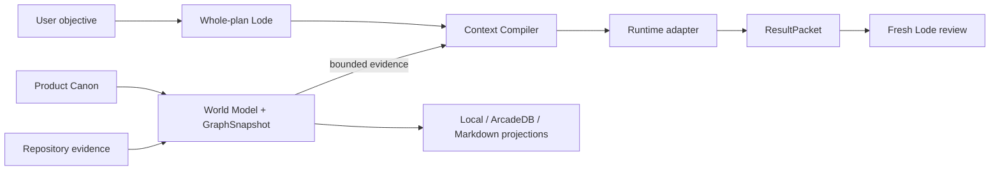
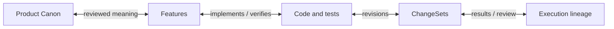

<p>
  
</p>

# Lode

[English](README.md) | [한국어](README.ko.md) | [Documentation](docs/README.md) | [한국어 문서](docs/ko/README.md)

Keep the project's direction and the reasons behind changes across AI conversations.

Lode works with Codex, Claude Code and OpenCode. It restores saved work after compaction and prepares context for the task at hand.

[](https://github.com/binary1215/lode/actions/workflows/go-worker-build-release.yml)


<details>
<summary>On this page</summary>

[Why use it](#why-use-it) ·
[Who it is for](#who-it-is-for) ·
[How to use it](#how-to-use-it) ·
[Install](#install) ·
[Advanced use](#cli-automation-and-advanced-setup) ·
[Core model](#core-model) ·
[Graph](#graph-and-records) ·
[Capabilities](#capability-status) ·
[Docs](#documentation)

</details>

## What Lode Agent Core does

Lode records the agreed goal, the evidence behind changes and what remains to do. Later conversations can read those project records instead of relying on the old chat's memory.

Use your coding agent in Codex, Claude Code or a configured OpenCode workspace. There is no separate application to operate.

<a id="first-request"></a>

## Your first request

Not installed yet? Give your coding agent this README and ask:

```text
Install Lode for Codex using its existing official installation path. Reuse a
valid installation and preserve my project instructions and current connections.
Do the steps you are allowed to perform; tell me only what needs my action.
Then use it in this project to investigate the login failure.
```

Replace Codex and the task with your client and goal. This starts from the
README even without an installed Skill. The agent performs the authorized
steps it can, checks the results, and continues your task. You may still need
to approve Host access, log in or restart the app yourself. The agent does not
restart it for you.

After [installing and loading the plugin](#install), open your project and include the real task in your first request. There is no separate setup conversation.

```text
Use Lode Agent Core for this project. Resume its existing state if one exists;
otherwise initialize the Core. Then find the cause of this login failure and fix it.
```

Replace the login failure with your own task. Lode continues it after initialization and verified recovery; you can keep asking for work in the same conversation.

## How to use it

Start with [the first-request example](#first-request). Describe the outcome you want, then work in ordinary language.

```text
Prepare only the code and decision evidence needed for this change, then proceed.
```

```text
Keep one overall plan and use parallel workers only for the independent parts.
```

Lode normally works directly. When delegation helps, it gives the current tool's workers a clear scope, checks their results and combines them. If the tool cannot delegate, Lode continues directly or sequentially. Ordinary delegation does not require a managed Run, worker registry or extra approval.

### Separate conversations, shared direction

Independent tasks can keep separate work Sessions while sharing the project goal and current constraints. Starting a new conversation preserves other tasks' progress. You do not maintain Session IDs or routing forms. See [Graph discovery and independent Sessions](docs/graph-discovery.md).

After compaction or provider replacement, conversation entry checks the available saved work direction. You do not need to request recovery or supply a checkpoint ID.

The Claude Code and Codex packages include SessionStart context delivery, including compact. The OpenCode V1 plugin supplies context on each model request, including summary and subsequent ordinary requests; it is not a post-compaction event.

These paths read saved records. They do not capture unsaved conversation or perform managed one-shot continuation. Installed Host and live-model verification remain separate. See [the support limits](#capability-status).

You do not write JSON, operate GraphDB, choose a token tier or decide which MCP call to make. Lode asks when a decision belongs to you: for example, approving product meaning, resolving an ambiguous scope, or allowing a consequential external change. Ordinary investigation and small authorized fixes stay ordinary work.

## Why use it

It is most useful when the project lasts longer than one conversation.

### Continue after compaction or session loss

Continue from the saved purpose, decisions, progress and next step. Recovery checks current constraints, and a newer user request wins over an older continuation. Lode saves checkpoints at meaningful changes or handoffs. Short investigations can retain selected reasons and uncertainty without a Run or checkpoint; neither needs a record on every turn.

Recovery covers recorded work direction, so unsaved conversation may be lost. Host support differs; see [Compaction recovery](docs/compaction-recovery.md), [Session recovery](docs/session-recovery.md) and [Session work context and Host support](docs/session-work-context.md).

### Give each task bounded, reviewable context

Describe the change. Lode reads the repository and selects the code and decision evidence it needs. When a context handoff is useful, the Context Compiler packs that material and reports exclusions and uncertainty. Keyword overlap does not prove relevance. You do not fill in evidence forms or manage budgets, and the compiler does not certify inclusion or semantic sufficiency. See [Context Compiler](docs/context-compiler.md).

### Review why a change happened

Git shows changed bytes. Lode also keeps the intended outcome, permitted scope, checks, review and next step. In managed work, a worker result cannot approve itself: independent review and the explicit decision stay separate. See [Execution Lineage](docs/execution-lineage.md) and [ChangeSets](docs/change-sets.md).

Inspect recorded reasons and cited source differences in the [recorded context view](docs/context-lineage.md), or ask Lode for a local, read-only [Graph Explorer snapshot](docs/graph-explorer.md). Citations and nearby nodes do not by themselves prove what caused a change.

### Connect product intent to code and tests

Trace reviewed product concepts to files, symbols and tests, then inspect suggested change impacts. Inferred meaning stays a candidate until the user accepts it. See [Feature mapping](docs/feature-mapping.md).

### Additional benefits

Optional workflows record Git and deployment evidence, product-specific observations, policy drift and measurements. Collected data does not become a product decision on its own, and a missing connector does not block ordinary coding. Built-in analytics and production-database connectors are not all provided. See [the capability list](#capability-status) and [documentation](#documentation).

## Who it is for

| If you… | Lode helps you… |
| --- | --- |
| Build a product over many AI conversations | Continue without re-explaining its direction each time. |
| Maintain a large or long-lived repository | Find the evidence needed for a change, including earlier decisions. |
| Coordinate teammates or several workers | Keep ownership, results and review distinct while integrating one outcome. |
| Switch between Codex, Claude Code and OpenCode | Keep project records independent of a provider conversation. |

For a one-off script or a short experiment where chat history is enough, you may not need it. Lode does not make model output automatically trustworthy, and a graph or database is not the authority for what the product should mean.

## Install

Choose the path for your tool. The Codex and Claude Code packages include the conversation Skill, MCP server and verified native bundle for supported hosts. Only the matching host binary runs. OpenCode uses the project setup below; the CLI is optional for ordinary conversation.

[Install for Codex](#codex-git-marketplace) ·
[Install for Claude Code](#claude-code-git-marketplace) ·
[Set up OpenCode](#claude-code-and-opencode-project-projections)

Installation puts files in place. Project initialization/resume connects the
chosen repository; optional instruction linking preserves your existing text.
The agent checks Host tool loading separately. A package version or generated
file alone does not prove that the Host loaded it. You do not need another
doctor/setup step before starting ordinary work.

New installations use `lode-agent-core@lode-agent-plugin`. Already using HEAD? Keep updating your existing installation; no second plugin or project-record conversion is needed. The MCP server is named `lode`.

If Host permissions or automation name `mcp__head_core__...` or
`mcp__lode_core__...`, they do not migrate through the Core's `head_*` aliases.
After loading an update, inspect the Host's actual MCP tool list for server
`lode` and use those exact names when updating your own rules. Preserve the
existing configuration and running connection until you choose to change them;
a disk update alone does not reload the Host. See the
[MCP-name details](#mcp-name-details).

### Codex Git marketplace

Intermediate betas use verified marketplace publication; Git tags are reserved
for separately designated releases. See the [changelog and publication policy](CHANGELOG.md).

The repository is `binary1215/lode`. Its Lode marketplace is published on
`lode-codex-marketplace`; the former repository URL still redirects here.

```powershell
codex plugin marketplace add binary1215/lode --ref lode-codex-marketplace
codex plugin add lode-agent-core@lode-agent-plugin
```

Restart Codex after installation, start a new task so the installed Skill and
MCP server are loaded, then use [the first-request example](#first-request)
with your own task.

Installing the plugin does not initialize a project, contact GraphDB, choose
a model or approve Product Canon. Those operations still use the typed Core
boundary and require explicit user review where consequential.

### Claude Code Git marketplace

```powershell
claude plugin marketplace add binary1215/lode@lode-claude-marketplace
claude plugin install lode-agent-core@lode-agent-plugin
```

Restart Claude Code after installation so the installed Skill and `lode`
MCP server are loaded, then use [the first-request example](#first-request)
with your own task.

Claude Code copies the plugin into its versioned cache and locates the MCP
entry through `${CLAUDE_PLUGIN_ROOT}`. The source Core and existing Project
identities stay unchanged. Installation alone does not authorize project
changes, Product Canon review, GraphDB access or a model choice.

### Claude Code and OpenCode project projections

When using the user-scoped installation below, initialize the project with
`--runtime opencode` for OpenCode or `--runtime claude` for Claude Code. Use
`--runtime codex` for Codex; combine these only if you want multiple integrations.
Marketplace-installed Claude Code users can
request the same initialization through the bundled Skill. Lode creates
`CLAUDE.md` plus `.mcp.json` for Claude Code, `AGENTS.md` for Codex, and
`opencode.json` for OpenCode only when those project files are absent. Existing
files are preserved and generated manual-integration projections remain under
the selected root's `.lode/generated/` or existing `.head/generated/` directory.

OpenCode's local configuration names `node` and `{env:LODE_PLUGIN_ROOT}` rather than
an absolute Node binary or install path. Claude Code uses `${CLAUDE_PLUGIN_ROOT}`;
Codex uses the plugin-relative `.mcp.json` and `${PLUGIN_ROOT}` in hooks. Set
`LODE_PLUGIN_ROOT` to the Lode install when OpenCode is started without the
packaged plugin. The packaged plugin can repair an empty env-expanded path in
memory only when the original managed configuration hash and current package
identity match; it does not take over a user-owned or edited configuration. If the
installation path changes, install Lode on that PC and ask the agent to resume
the existing Project. At the same canonical Project path, this preserves Project
and Session IDs and the selected runtimes while updating the host installation
identity. The shared launch files stay portable.
A project-owned `opencode.json` stays unchanged; the generated copy remains
available for manual integration.

If you move or copy the complete Project folder, explicitly resume it at the new
path. Lode verifies the retained owner and preserves Project/Session IDs and
historical records; a status read alone does not adopt the new location. This
does not transfer a native Host binding or replay execution. See
[Session recovery](docs/session-recovery.md). Check the running Host's MCP tool
loading separately.

If you choose instruction linking during setup, Lode can append a small block
to an existing instruction file once, preserving its original content. Claude
Code uses its instruction-file imports; Codex receives a directive to read the
project instructions. Declining leaves the file unchanged and does not block
your task or trigger another setup offer. See the installation guidance for
your Host; generated instructions alone do not prove that a running Host read them.

After initialization, start `claude` or `opencode` in the project. Claude Code
asks for project MCP approval before using the shared `lode` server. The
runtime-native instruction/config files are projections; the selected `.lode/`
or existing `.head/` remains the single canonical Project root.

### User-scoped CLI

<details>
<summary>Show the optional user-scoped CLI installation</summary>

Supported runtime: Node.js 24 or newer; CI uses Node.js 24.18.0. You also need
either Git or a downloaded source archive. Git inside the target project, Go, GraphDB, and a provider
runtime are optional.

Windows PowerShell:

```powershell
git clone https://github.com/binary1215/lode.git lode
Set-Location .\lode
.\scripts\install.ps1 --native auto --project C:\path\to\project --runtime codex

lode-agent --version
```

macOS or Linux:

```bash
git clone https://github.com/binary1215/lode.git lode
cd lode
./scripts/install.sh --native auto --project /path/to/project --runtime codex

lode-agent --version
```

The installer stages a content-verified release in the current user's data
directory and writes launchers to `~/.local/bin`. It does not edit a shell
profile, a Codex cache, remote GraphDB, or an existing project before the
explicit `--project` initialization step.
The example selects Codex only; replace `codex` with `claude` or `opencode` for
that client. `--version` identifies the executing CLI, not the running Host's
loaded tools. Use existing status/doctor diagnostics only when needed.

</details>

<details>
<summary id="mcp-name-details">Already using HEAD? Installation identity and MCP-name details</summary>

New Lode installations use `lode-agent-core@lode-agent-plugin`, `lode_*` and Lode Skill names. Existing `codex-marketplace` and `claude-marketplace` addresses keep `head-agent-core@head-agent-plugin`, `head_*` and their existing Skill names. Each package registers one `lode` server and lists one tool vocabulary; both run the same implementation. Keep the marketplace you already use rather than installing both.

For an existing HEAD installation, continue with its usual update commands:

```powershell
codex plugin marketplace upgrade head-agent-plugin
codex plugin add head-agent-core@head-agent-plugin
```

```powershell
claude plugin marketplace update head-agent-plugin
claude plugin update head-agent-core@head-agent-plugin
```

Existing `.head/` records, IDs and selected Session stay intact; new projects use `.lode/`. Known operation aliases are not redirects for the Host-owned `mcp__head_core__...` or `mcp__lode_core__...` names. A disk update does not reload a running Host. Existing user-owned configuration is preserved, and generated alternatives use the new server name. Historical packages retain their exact bytes and namespace for verified rollback.

</details>

## Capability status

These labels describe the source distribution. They do not certify that a particular installed Host or live model has been tested. Saved-context delivery does not include unsaved conversation capture or managed automatic continuation.

<details>
<summary>Implemented, experimental and unshipped capabilities</summary>

- Available: implemented in the current source distribution;
- Experimental: implemented behind an explicit or limited activation path;
- Planned: accepted direction but not shipped;
- Deferred: intentionally outside the current milestone.

| Area | Capability | Status |
| --- | --- | --- |
| Project | initialization, Source Scope, review-gated Product Canon | Available |
| Knowledge | graph-first bounded discovery with source fallback, World Model, incremental refresh, optional Context Capsules | Available |
| Sessions | request-local logical Sessions and current common direction with exact-basis updates | Available |
| Sessions | optional subagent state-write guard, off unless `LODE_SUBAGENT_WRITE_GUARD=enforce` | Experimental |
| Lineage | Runs, ResultPackets, Fresh Lode review, P2 Session and conversation-entry recovery | Available |
| Host lifecycle | provider-neutral compaction and at-most-once continuation contract, requiring a trusted Host adapter | Experimental |
| Host context | packaged Claude Code and Codex SessionStart delivery, including compact | Available |
| Host context | packaged OpenCode V1 per-model-request delivery, including summary and ordinary requests; not a post-compaction event | Available |
| Host context | bounded non-authoritative user-prompt reference after compact and clear for Claude Code, Codex, and OpenCode | Available |
| Runtime | Claude Code, Codex, and OpenCode one-shot Session/Run execution | Available |
| Runtime evidence | deterministic three-runtime fixtures and local CLI capability probes | Available |
| Runtime evidence | Claude Code live model-call conformance | Experimental |
| Release evidence | provider-neutral Git ref, deployment-result, and release observations | Available |
| Delivery evidence | provider-neutral per-environment/target applied, failed, and rollback history with exact optional source-revision links | Available |
| Common observations | reuse-first exact evidence preparation plus paged Host source discovery and opaque-ID collection | Available |
| Product policy | schema-v2 Policy proposal, exact application and semantic references, user review, evidence-currentness diagnostics, revision and retirement lineage | Available |
| Measurement | versioned metric definitions, exact observations, condition-aware comparison, non-causal assessment and bounded lineage | Available |
| Workers | bounded dispatch, wait, result, review, integration | Available |
| Coordination | ordinary Host delegation and optional exact-endpoint attachment | Available |
| Projection | local graph and Markdown | Available |
| Projection | ArcadeDB | Experimental |
| Distribution | user-scoped install, native delivery, rollback, safe removal | Available |
| Distribution | verified Git-backed Codex marketplace | Available |
| Distribution | verified Git-backed Claude Code marketplace | Available |
| Distribution | portable Claude Code, Codex, and OpenCode MCP launch paths | Available |
| Distribution | OpenAI universal plugin directory | Planned |
| Runtime | general provider-session resume and streaming | Deferred |
| Documents | Obsidian and Notion adapters | Deferred |

For exact claims and acceptance evidence, use the subsystem documents and source
verification rather than inferring capability from this summary.

</details>

## Documentation

For changes and sensitive findings, see [Contributing](CONTRIBUTING.md) and
[Security](SECURITY.md). Neither document grants deployment or publishing permission.

Browse the [complete English documentation index](docs/README.md) or the
[complete Korean documentation index](docs/ko/README.md). Every public English
subsystem document has a Korean counterpart; code, command names, protocol
identifiers, and artifact field names remain unchanged across languages.

<details>
<summary>Subsystem guides</summary>

- [Recovery, Session selection and World freshness](docs/recovery-state-separation.md): distinguish saved direction from Session routing and derived World state;
- [Architecture](docs/architecture.md): the provider-neutral composition;
- [Authority planes](docs/authority-plane-contract.md): the executable
  Graph/record and non-amplification contract;
- [Onboarding](docs/onboarding.md): Lode semantic proposals, Core verification, and explicit review;
- [Context Compiler](docs/context-compiler.md): reproducible task context;
- [Work artifact storage](docs/artifact-storage.md): where to save evidence without extra ceremony.
- [Execution Lineage](docs/execution-lineage.md): plans, contracts, results,
  review, and recovery;
- [World Model](docs/world-model.md): source evidence and graph construction;
- [Runtime adapters](docs/runtime-adapters.md): capability, invocation, and
  process ownership;
- [Performance fast path](docs/performance-fast-path-design.md): optimization
  without semantic or authority shortcuts.

Additional references:

- [Product Model](docs/product-model.md)
- [Product Operating Loop](docs/product-operating-loop.md)
- [Release observation](docs/release-observation.md)
- [Common Observation contract](docs/observation-adapters.md)
- [Delivery state observation](docs/delivery-observation.md)
- [Non-blocking Conformance reconciliation](docs/conformance-reconciliation.md)
- [Incremental refresh](docs/incremental-refresh.md)
- [Compaction recovery](docs/compaction-recovery.md)
- [Session recovery](docs/session-recovery.md)
- [Ordinary Host delegation and optional attachment](docs/role-coordination.md)
- [Graph projection adapter](docs/graph-projection-adapter.md)
- [Document projection adapter](docs/document-projection-adapter.md)
- [Codex marketplace distribution](docs/codex-marketplace.md)
- [Claude Code marketplace distribution](docs/claude-marketplace.md)

Installed behavior is governed by these runtime contracts, the target project's
user-owned Canon, current Session/Run recovery state, and explicit
ReviewDecisions. Repository-development history, benchmark fixtures, and
maintainer milestones are evidence about the plugin; they are not instructions
for a project using it.

</details>

## CLI, automation, and advanced setup

<details>
<summary>CLI commands and context preparation</summary>

The normal path is the conversation-first flow above. Use the following CLI
surface when a script, CI job, offline recovery procedure, or host integration
needs the same deterministic Core behavior without a guided conversation.

The default path initializes only the provider-neutral Lode constitution and its
fixed Project/Session recovery anchors:

```powershell
lode-agent init C:\path\to\project --runtime claude,codex,opencode
```

It returns `core_ready`, preserving identities and updating the lightweight
existing-observation index where available. Product inference, governed World
construction and document governance remain optional. The same bounded status is available
at any time:

```powershell
lode-agent status C:\path\to\project
```

Successful human-readable status is intentionally one line. Exceptions name
the owner, reason, affected operation, and next action; `doctor` or `--json`
shows Core, optional Product governance, Context readiness, executing CLI/library
and configured package versions, and technical details. Host tool loading is not
observed by that package inspection. The structured projection separates
`readiness.core`, `readiness.product`, and `readiness.context`, names one
`nextAction`, and lists optional capabilities with their real prerequisites.
For example, Product appears as `available-not-activated`, while bounded workers
appear as `requires-session-or-run-authorization` for retained managed work.
Ordinary second opinions use available Host delegation; worker count alone does
not require a Run. This is a non-persisted advisory
projection: reading it never activates Product, creates a Run, grants authority,
or repairs drift. `profile` remains a choice for one initialize/resume operation,
not a hidden project mode.

Top-level status is one of `core_ready`,
`product_evidence_required`, `product_review_required`, `product_ready`,
`product_refresh_required`, or `core_drifted`. The exact lower-level onboarding
state remains visible under `readiness.product.onboardingStatus`.

### Conversational Context preparation and preview

In conversation, describe the task once. Ordinary reading and editing use the
needed files directly. Only when reproducible selected-context handoff, a durable
Run or recovery actually needs a Capsule does the Lode Skill call
`lode_context_prepare`, perform semantic repository inspection, author any
task-required `EvidenceNeed[]`, and call `lode_context_preview` without asking
the user to operate those steps. Missing or stale optional World evidence does
not block direct work, and justified budget expansion is automatic.
The final preview includes one explanation card with included evidence by kind,
intentional omissions by reason, and remaining uncertainty. It does not add a
new gate: mechanical coverage still belongs to Core and semantic sufficiency
still belongs to Lode.

The default MCP list stays focused on Core work, recovery and retained-work
status/cancellation. Lode can find optional Product, Graph, Observation or Context
schemas with `lode_tools_discover`, then use the returned read-only or effectful
route. You do not need to unlock capabilities, select a profile on every request
or type JSON. Discovery adds no authority; existing operation checks still apply.

The same Core operations remain available from the CLI for automation and
diagnosis:

```powershell
lode-agent context-prepare C:\path\to\project --task "<task>"
```

This task-only, non-persisted P4 projection returns the current Project,
World Model, and GraphSnapshot binding plus bounded lexical discovery material
and exact node identities. The user does not write `EvidenceNeed[]`. Lode uses
ordinary semantic reasoning and repository inspection to author the structured
proposal, then gives that proposal to the existing preview verifier. Core does
not select evidence kinds or anchors, and absence from the lexical candidate
view never means irrelevance.

If Product/World has not been activated, preparation still returns
`ready_for_head_semantic_assessment`, discloses missing repository metadata and
provides available curated context. Lode may inspect current source directly.
Preparation never activates Product, indexes the repository or creates recovery
records. Optional Product/World work is chosen only when the task needs it.

Advanced automation may call the preview directly with Lode-authored structured
input:

```powershell
lode-agent context-preview C:\path\to\project `
  --task "Keep this exact task text across retries" `
  --budget 32768 `
  --evidence-needs .\evidence-needs.json
```

CLI output is concise by default. Add `--json` for selected context, sources,
omissions and uncertainty. One preparation or preview call is enough when its
evidence is useful; a separate preview is optional, not a setup ritual.

`ready_for_head_semantic_assessment` means Lode should assess the selected
context, not that the tool has proved completeness. Lode reads original bodies
when needed and can expand a returned graph anchor with `details: true`.
Missing/stale World is disclosed; direct current source remains available.
No fixed budget tiers, inclusion certificate or extra user approval is required.

### Conversation-first path

The bundled `lode-agent-onboarding` Skill is the interactive entry for optional Product onboarding.
It inspects the current state, asks only for material choices such as repository
scope or storage mode, semantically analyzes bounded current evidence, submits a
typed proposal for Core verification, presents the resulting evidence-linked
candidates, and uses explicit review before Product Canon changes. It selects
the `product` profile explicitly. The provider proposal remains P3 evidence.

### Optional Product profile CLI path

Initialize or resume the same project and Lode Session identities:

```powershell
lode-agent init C:\path\to\project --runtime claude,codex,opencode --profile product
lode-agent onboarding-status C:\path\to\project
```

Without a structured user brief, first use intentionally returns
`awaiting-evidence`; Core does not invent product concepts from symbols. The
conversation Skill normally supplies the fresh semantic proposal. CLI users may
pass the same `semanticProposal` inside `--input`; after Core verifies the exact
SourceSnapshot, paths, lines, optional symbols, and Product Model references, an
immutable candidate-set ID is returned. Inspect it before review:

```powershell
$onboarding = lode-agent onboarding-status C:\path\to\project | ConvertFrom-Json
lode-agent onboarding-candidates C:\path\to\project `
  --candidate-set $onboarding.state.candidateSetId
```

Create `onboarding-review.json` only after reviewing the evidence. This compact
example accepts the complete bootstrap batch; selection or revision is safer
when any candidate should be renamed, split, merged, or excluded.

```json
{
  "candidateSetId": "onboarding-candidates-<id>",
  "disposition": "accept-all",
  "rationale": "I reviewed every evidence-linked candidate and adopt this bootstrap batch."
}
```

Apply the decision and verify the resulting views:

```powershell
lode-agent onboarding-review C:\path\to\project --input .\onboarding-review.json
lode-agent graph-query C:\path\to\project --query "<task>"
lode-agent world-status C:\path\to\project
lode-agent context-preview C:\path\to\project `
  --task "Find implementation evidence for one reviewed Feature" --budget 32768
lode-agent world-docs-build C:\path\to\project
lode-agent resume C:\path\to\project --runtime claude,codex,opencode --profile product
```

`accept-all` is supported for a fully inspected batch, but it is not the default
recommendation. Review can instead accept a dependency-complete selection,
revise or reject the batch, request more evidence, or retain explicit Unknowns.
See [Onboarding](docs/onboarding.md) for the complete contract.

### Source scope

For repositories with generated output, vendored dependencies, copied projects,
large fixtures, or model bundles, define a project-relative observation boundary
before the first index:

```json
{
  "mode": "existing",
  "sourceScope": {
    "includeRoots": ["src", "packages"],
    "excludeRoots": ["dist", "vendor", "generated", "fixtures"]
  }
}
```

Pass it with `lode-agent init ... --profile product --input .\onboarding.json`. Source Scope
controls observation only; it cannot define Product Canon, approve a candidate,
or grant execution authority.

</details>

## Core model

<details>
<summary>Authority, context and recovery contracts</summary>

Lode separates meaning, recovery, evidence, views, and effects so that one
representation cannot inherit another's authority.

| Plane | Owns | Examples | Does not authorize |
| --- | --- | --- | --- |
| P1 Normative authority | approved meaning and explicit decisions | Product Canon, ReviewDecision | inference from a graph, result, or message |
| P2 Recovery and lineage | provider-independent project direction | Session, Run, plan, Capsule, contract, checkpoint | rewriting direction from a summary or result |
| P3 Evidence | reviewable observations and results | candidates, ResultPacket, ChangeSet, receipts | self-promotion or checkpoint authorship |
| P4 Derived views | reproducible retrieval and human views | GraphSnapshot, traversal, Markdown, continuity | Canon mutation or unique recovery |
| P5 Operational effects | host-local execution and delivery | PID, lease, endpoint, inbox, delivery receipt | execution, review, promotion, or recovery authority |

Distribution and host integrations package or execute these contracts; neither
becomes a sixth source of product meaning. The complete executable boundary is
documented in [Authority planes](docs/authority-plane-contract.md).

The smaller normative root and the formal Record/Graph boundary are documented
in [Provider-neutral Lode constitution](docs/lode-constitution.md).

### Architecture at a glance



The feedback path is explicit: an accepted result may become reviewed lineage,
the repository can be re-indexed, and a later graph may project that evidence.
No result, projection, or runtime effect accepts itself.

### Lode judgment with reproducible selected context

The Context Compiler packs evidence selected for the task under an explicit budget.
It records what was included, excluded, stale, missing, truncated, or unknown.
The same canonical inputs, compiler version, traversal policy, and budget
reproduce the same Context Capsule.

The default budget is `32768` approximate tokens, and Lode may use any positive
safe integer. There is no five-tier ladder or 512K policy ceiling. Actual provider
context fit and output reserve still apply; the estimate is not a tokenizer proof.

Lode may guide selection with exact repository paths, Product Canon keys,
Observation IDs or bounded current graph anchors. The compiler supplies
`evidenceGaps`, `omissions` and `uncertainty`, not an inclusion-proof gate.
Lode decides whether more source evidence is needed. A persisted ExecutionContract
records that separate judgment; it does not manufacture semantic acceptance.

A Capsule is a derived execution input, not a second Canon. Digest or Canon drift
fails closed; simple read/reason work does not create a Capsule by default.

### Execution and recovery

Managed execution follows this durable, reviewable sequence:

```text
WholePlanSnapshot
  → ExecutionContract + ContextCapsule
  → runtime or bounded worker
  → ResultPacket
  → Fresh Lode ReviewDecision
  → accepted lineage or a revised plan
```

Provider loss does not require importing a transcript. `session-restore`
reconstructs the current input from the exact P2 checkpoint and verified lineage.
After an accepted result, `run-integrate-checkpoint` can bind that review to a new
checkpoint only when Lode or the user explicitly supplies its recovery fields.

With a trusted Host adapter, managed intentional compaction uses this contract.
Packaged read-only context delivery does not perform this whole lifecycle:

1. provider Lode writes or reuses the exact P2 direction before compaction;
2. a provider-neutral Host adapter retains the one-time transport token outside
   project Canon and performs the provider-owned compaction;
3. Core restores P2 first, then verifies trusted real-user-turn evidence and
   rejects drift, uncertain replay, or summary-derived recovery;
4. the Host submits the checkpoint-bound continuation at most once, or Lode
   continues as a disclosed fresh logical Lode from the verified artifacts.

The normal UX is simply to continue the task. `lode_conversation_enter` is the
automatic read-only entry projection used by the Skill, while the `compact-*`
and `lode_compaction_lifecycle_step` surfaces are advanced adapter and diagnostic
operations. Missing Host hooks do not create a setup gate and never block
ordinary work.

For a durable direction update, the Skill internally uses the read-only
`lode_checkpoint_basis` and idempotent `lode_checkpoint_sync` surfaces. Core
returns `created`, `reused`, `deferred`, or `conflict`; only the affected recovery
path pauses, and none of these outcomes asks the user for checkpoint JSON.

When recovery needs explanation, `lode_checkpoint_diagnose` gives one bounded,
read-only answer: the current pointer, artifact-restore result, mechanical update
availability, and the next Lode action. It writes no lock or cache and never calls
another model merely to read status. Matching IDs and hashes prove artifact
consistency, not that checkpoint prose still matches the latest user intent.
Changed sequential reads require a retry; the result explicitly does not claim an
atomic filesystem snapshot or ABA detection. Ordinary independent work remains
available while only checkpoint-dependent work pauses on a real recovery fault.

A newer real user turn wins over a pending continuation. See
[Compaction recovery](docs/compaction-recovery.md) and
[Session recovery](docs/session-recovery.md).

### Product learning

Everyday observations can remain non-persisted notes. Durable artifacts are
created only when another Run, audit, product-state transition, or handoff needs
them:

```text
Signal → Hypothesis → Initiative candidate → user ReviewDecision
       → reviewed Initiative → accepted execution → OutcomeObservation
```

This is not one automatic promotion chain. Evidence remains evidence,
hypotheses remain hypotheses, and a reviewed Initiative remains distinct from
Product Canon. Lode judges risk and persistence directly, without a recommendation
API or a note-formatting call:

- Observe for read and reasoning work;
- Session for one bounded, reversible result;
- Run for dependent or recovery-sensitive work;
- Explicit authority for Canon, initiative decisions or effects outside the current
  approved scope. Updating a useful checkpoint within already approved direction
  is not a new user decision.

See [Product Operating Loop](docs/product-operating-loop.md).
Git ref and deployment plumbing is documented in
[Release observation](docs/release-observation.md).
Per-environment and per-target application, failure, and rollback history is
documented in [Delivery state observation](docs/delivery-observation.md).

</details>

## Graph and records

<details>
<summary>Snapshots, history and graph queries</summary>

Graph Explorer's `graph-explorer <project-directory>` CLI creates a read-only
HTML snapshot of the target project's evidence, not the plugin installation.
Ask the agent to run that existing CLI; there is no dedicated HTML-export MCP
tool. It is not a live view. See [Graph Explorer](docs/graph-explorer.md) for
search, explicit history and sharing options.

For new project information, Lode uses bounded `lode_project_graph` discovery
first, or reuses sufficient results from the same basis. Work and Product views
reference the same original records. The result keeps revision, provenance,
coverage and candidate/rejection state, including intact history. Missing or
failed layers lead to original-source inspection without requiring whole-World
currentness, Product approval, Run/Capsule or ArcadeDB. Empty partial results do
not prove absence; effects separately recheck current sources and authority.
The query does not generate a new artifact per read. See
[Graph discovery and independent Sessions](docs/graph-discovery.md).


A `GraphSnapshot` is the immutable, content-addressed evidence graph embedded in
one verified Repository World Model. It is not a graph UI screenshot, database
backup, or mutable latest-node collection. The same verified inputs produce the
same `graphSnapshotId`; semantic changes create a new snapshot with explicit
ancestry.

`lode_world_model` verifies that complete model and current repository, then
returns a bounded status projection instead of transporting the full snapshot.
Counts, IDs, digests, samples, and omission metadata stay available; deeper
inspection uses the bounded graph, history, runtime, and semantic query tools.
This keeps MCP responses small without skipping any freshness or digest check.



Raw prompts stay outside this graph. Product meaning enters only through
reviewed Canon. General discovery may show labelled candidates/rejected records
without promoting them; they remain excluded from Canon Context compilation.

Common Observations keep their exact descriptor, receipt, and derivation
lineage in the same temporal graph. A ProductHypothesis may point to an exact
Observation, but that edge remains evidence for a hypothesis rather than a
promotion of measured data into product truth. If Observation storage is
damaged, only that graph layer is reported unavailable; unrelated product work
continues.

Delivery observations add practical operational genealogy without turning the
graph into a deployment controller. Each Host event names an environment,
target, artifact revision, explicit sequence, and predecessor. The read-only
current-state card shows uniform, mixed, or unknown observed state; failed
attempts do not erase the last applied revision, rollback remains in history,
and unobserved targets are never guessed successful. Exact retained source
revisions receive verified `AT_REVISION` links; declared strings stay visibly
unverified.

Policy genealogy stays equally explicit. A proposed create, revision, or
retirement is P3 evidence until the user accepts that exact candidate. The
accepted decision points to the resulting Product Model revision and to the
matching current Policy revision, even after an unrelated Policy is added.
General graph discovery retains an unreviewed Policy candidate's original state;
legacy governed traversal can exclude it and Canon compilation does not promote it.

Source relations are structural evidence, not product meaning. The default
heuristic import/call graph remains available, while an optional provider-neutral
language-AST adapter may add separately labeled, exact-file-bound evidence. One
source never silently overwrites the other, and neither can approve a decision.

### Graph versus record

Records feed the graph and its projections in this direction:

```text
P1 Product Canon + observed source + verified P2/P3 records
  → P4 Repository World Model containing a recoverable GraphSnapshot
      → replaceable graph materialization: local JSON / optional ArcadeDB
      → replaceable human projection: Markdown
```

The graph owns navigation, not meaning or recovery direction. Deleting GraphDB
or generated Markdown must leave Product Canon, Session/Run recovery, and review
lineage intact. A stale, tampered, or semantically divergent projection fails
closed instead of redefining the graph.

### Query the graph

```powershell
lode-agent world-status C:\path\to\project
lode-agent world-temporal C:\path\to\project `
  --query "<Feature, symbol, path, ChangeSet, or ReviewDecision>" `
  --depth 3 --limit 100 --edge-limit 200
lode-agent graph-lineage-status C:\path\to\project
lode-agent graph-lineage-trace C:\path\to\project --anchor <exact-node-id>
lode-agent graph-lineage-diff C:\path\to\project `
  --from <older-world-model-id> --to <newer-world-model-id>
lode-agent context-preview C:\path\to\project --task "<task>" --budget 32768
```

Traversal returns snapshot, query, and result identities plus inclusion,
exclusion, and truncation reasons. Embedded, local JSON, and activated ArcadeDB
backends must preserve the same semantic result.

The lineage commands reuse retained content-addressed World snapshots and do
not create another history stream. Their Hot/Warm/Cold status, trace, execution
overlay, and diff are non-persisted P4 views. An exact-content file move is only
reported as a possible move; semantic identity is never asserted automatically.

</details>

## Runtime and coordination

<details>
<summary>Workers, adapters and attachment</summary>

Claude Code, Codex, and OpenCode are projections over one `.lode/` authority. Runtime adapters
observe capability, consume one exact authorization at most once, supervise the
owned process tree, validate structured output, and keep operational state
outside the project.

Ordinary delegation uses the current Host's tasks, messages and progress.
Lode provides context and ownership, combines successful contributions, inspects
unknown effects, and handles only the unfinished part. There is no Lode role-token,
generation, inbox or target-chain setup. Worker success cannot approve Canon or
write recovery direction.

Optional endpoint attachment first restores P2 direction, then attaches only if
the exact live endpoint can be verified. If the endpoint is gone, Lode reports
a fresh-logical-Lode fallback from the verified records. The portable export
bridge is attachment-only; it retains one
current snapshot, not a durable delivery mail service. Host-specific pane/socket/UI
behavior stays outside Core. See [Runtime adapters](docs/runtime-adapters.md)
and [Host delegation and attachment](docs/role-coordination.md).

</details>

## Optional GraphDB

<details>
<summary>ArcadeDB configuration and native query paths</summary>

Local storage is the default. GraphDB is not required for onboarding,
context compilation, execution lineage, or recovery.

ArcadeDB can be explicitly activated as a derived graph projection. Credentials
are resolved only through environment-variable references and never enter
project artifacts, graph identities, generated documents, or receipts. Remote
activation must prove semantic conformance with the recoverable embedded graph.

The JavaScript bridge is the semantic reference. When a verified native package
is present, read-only prepared queries may use a content-addressed Go query-batch
bridge; JavaScript still verifies the pointer, topology, traversal, request
binding, and receipt. Set `LODE_AGENT_ARCADEDB_NATIVE_MODE` to:

- `auto`: use the verified native bridge when available, otherwise disclose and
  use the JavaScript reference path;
- `off`: always use the JavaScript path;
- `required`: fail when the verified native path is unavailable.

Manifest, binary, and post-selection digest mismatches always fail closed.
Exact children receive only configured credential-reference variables and a
bounded OS, TLS, locale, and proxy allowlist. The compute worker itself remains
network-free and authority-free. See
[Graph projection adapter](docs/graph-projection-adapter.md).

</details>

## Installation lifecycle

<details>
<summary>Native delivery, upgrade and removal</summary>

### Native packages

User-scoped install and upgrade default to `--native auto`. The installer selects
the exact version and platform package, verifies release checksum, archive paths,
build metadata, and native manifests, then includes the binaries in the release
identity. Use `--native off` for JavaScript-only installation or
`--native required` when fallback is unacceptable.

Codex and Claude marketplace snapshots carry the same verified packages for all
five supported targets, so those installs do not need a runtime download. A
missing target, mixed build commit, or manifest/digest mismatch blocks
marketplace publication.

Native components have separate contracts for authority-free computation, owned
process supervision, and read-only ArcadeDB batching. Installing one never
changes Product Canon, graph identity, review authority, or lineage.

### Status, upgrade, rollback, and removal

Run lifecycle commands from the newly downloaded source tree:

```powershell
node .\scripts\distribution.mjs upgrade
node .\scripts\distribution.mjs status
node .\scripts\distribution.mjs rollback
node .\scripts\distribution.mjs uninstall
```

Upgrade stages and verifies an immutable release before replacing the active
pointer. Normal removal deletes launchers and the active pointer but preserves
verified releases for recovery. `uninstall --purge` also removes the user-scoped
release store. Neither form traverses or deletes project `.lode` state, Git data,
generated project documents, or GraphDB data.

Provider configuration and authentication remain owned by Claude Code, Codex,
or OpenCode. Lode passes only the exact authorized `provider/model` plus an
ephemeral permission/privacy overlay; it does not install provider presets,
copy credentials, or rewrite endpoints.

</details>

## Design principles

<details>
<summary>Design background and principles</summary>

Lode Agent Core Plugin is inspired by
[Won6314/head-agent-core](https://github.com/Won6314/head-agent-core) and
independently reworked as a provider-neutral plugin. It is not an official
upstream release or a drop-in replacement. See the
[source-grounded comparison](docs/original-head-core-comparison.md).

The implementation uses these principles across providers:

- Lode owns the connected whole outcome;
- the user retains consequential authority;
- semantic sufficiency belongs to Lode; bounded verified context beats maximum context;
- durable Canon survives temporary model sessions;
- delegation stays bounded and non-authoritative;
- completion requires connected primary evidence;
- graphs are retrieval indexes, not unquestioned authority;
- project meaning remains separate from runtime mechanisms.

Read the upstream
[Foundations](https://github.com/Won6314/head-agent-core/blob/ba220c55c14b8af947bf6d1fb9d27a620a2cf2aa/packages/core/docs/FOUNDATIONS.md)
and
[Technical Architecture](https://github.com/Won6314/head-agent-core/blob/ba220c55c14b8af947bf6d1fb9d27a620a2cf2aa/packages/core/docs/TECHNICAL_ARCHITECTURE.md)
for the original design context.

</details>

## Verify from source

<details>
<summary>Test commands and verification limits</summary>

Core verifies the exact target and permitted transition of a decision supplied
by a trusted local caller. The Host and Lode must convey the user's actual
approval; digests and confirmation flags do not authenticate a human.

Fixture tests establish reproducibility and transition behavior. They do not
establish Lode's evidence-discovery rate or end-to-end coding accuracy.
See [verification evidence and local diagnostics](docs/verification-evidence.md).

```powershell
npm test
npm run verify:newcomer
npm run verify:distribution
npm run verify:codex-marketplace
npm run verify:claude-marketplace
```

Native sources additionally support `go test ./...` and `go vet ./...` from the
corresponding module directories. JavaScript remains the semantic reference;
native backends are advertised only after fixture-driven conformance and
integrity verification.

</details>

## Status and licensing

Lode Agent Core Plugin is beta software: the provider-neutral constitutional
Core, recovery, Context Compiler, execution lineage, local projections, bounded
workers, and verified Codex/Claude distribution are ready for broader testing.
Capabilities marked Experimental, Planned, or Deferred above remain outside
that beta claim.

This project is released under the [MIT License](LICENSE).
Native binaries also carry [Go runtime and standard-library notices](native/GO-NOTICES.txt).
